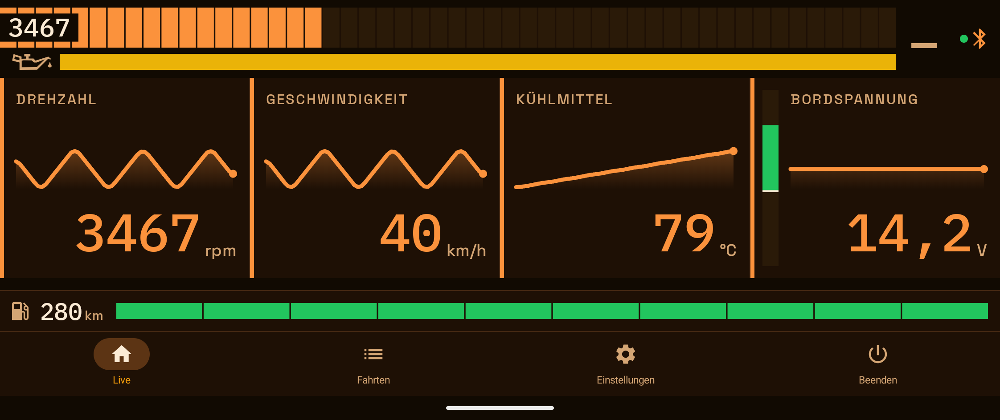
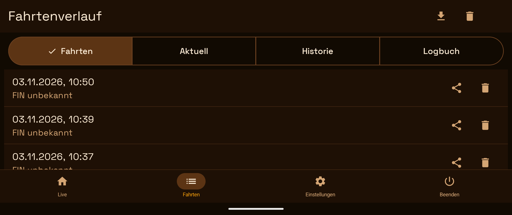
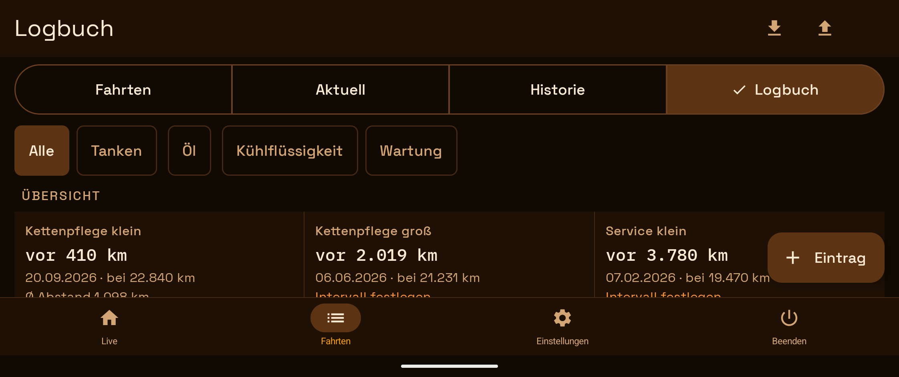
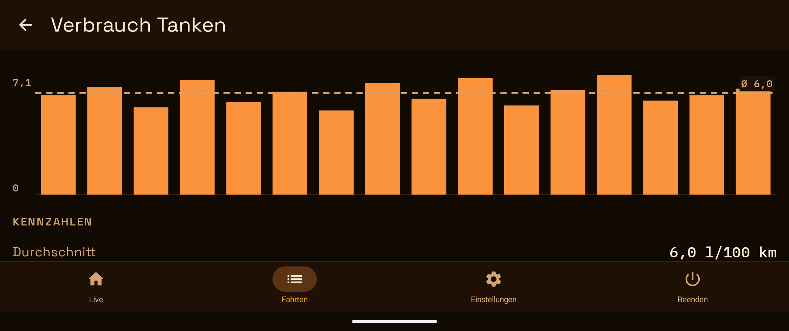

# OBD2 Monitor

English first, deutsch darunter. · Detailed documentation / Ausführliche Dokumentation: [English](docs/README.en.md) · [Deutsch](docs/README.de.md)



| | | |
|---|---|---|
| [](docs/images/drives.png) | [](docs/images/logbook.png) | [](docs/images/fuel-consumption.png) |

Debug build on a Pixel 8 Pro, landscape. **The values come from the built-in ECU simulator and from invented logbook entries — not from a vehicle.** / Debug-App auf einem Pixel 8 Pro, Querformat. **Die Werte kommen vom eingebauten ECU-Simulator und aus erfundenen Logbuch-Einträgen — nicht von einem Fahrzeug.**

## English

OBD2 Monitor is an Android app for live vehicle diagnostics through an ELM327-compatible OBD2 adapter over **classic Bluetooth (SPP)**. It was built for a motorcycle and works with any vehicle that has an OBD2 socket.

**What it does**

- Live dashboard with configurable tiles (RPM, speed, temperatures, voltage), a virtual gear indicator and a virtual fuel gauge
- Reads fault codes (DTCs) with descriptions and keeps a local fault history
- Records drives on the device, with CSV export
- Maintenance logbook with consumption analysis and "due in N km" reminders
- Alarms for voltage, coolant temperature and new fault codes
- Available in English, German and Spanish; Android 8.0 or newer

**Good to know**

- **Read-only:** the app never writes to the vehicle (OBD2 modes 01, 02, 03, 07, 09) — no clearing of fault codes, no coding.
- **A one-person project,** developed on **one** motorcycle with **one** adapter; other vehicles and adapters are untested. Adapters that only speak BLE do not work.
- **Do not operate it while riding or driving.** Gear, fuel gauge, range, the oil-temperature strip and the maintenance due-dates are estimates, not measurements.
- **No warranty** (Apache License 2.0), use at your own risk. Not affiliated with ELM Electronics or any vehicle manufacturer.
- **Privacy:** drives, logbook and settings stay on the device unless you export them. The only network use is the optional outside temperature (rounded location sent to Open-Meteo); no crash reports unless the app was built with a Sentry key.

**Build**

```bash
./gradlew assembleDebug        # APK: app/build/outputs/apk/debug/app-debug.apk
./gradlew testDebugUnitTest    # JVM tests, no device needed
```

You need JDK 21 (JetBrains) and the Android SDK with platform 37 — details in the [detailed README](docs/README.en.md#build--run).

**More**

- [Detailed README (English)](docs/README.en.md) · [Release notes](RELEASE_NOTES.md)
- [Contributing](CONTRIBUTING.md): issues are welcome, pull requests only after agreement in an issue · [Security](SECURITY.md) · [Code of Conduct](CODE_OF_CONDUCT.md)
- License: Apache License 2.0 — [`LICENSE`](LICENSE), [`NOTICE`](NOTICE). Third-party names are used descriptively only.

## Deutsch

OBD2 Monitor ist eine Android-App zur Live-Diagnose über einen ELM327-kompatiblen OBD2-Adapter mit **klassischem Bluetooth (SPP)**. Sie wurde für ein Motorrad entwickelt und läuft an jedem Fahrzeug mit OBD2-Buchse.

**Was sie kann**

- Live-Dashboard mit frei belegbaren Kacheln (Drehzahl, Geschwindigkeit, Temperaturen, Spannung), virtueller Gang- und Tankanzeige
- Liest Fehlercodes (DTCs) mit Beschreibung und führt eine lokale Fehlerhistorie
- Zeichnet Fahrten auf dem Gerät auf, mit CSV-Export
- Wartungslogbuch mit Verbrauchsauswertung und Erinnerungen „fällig in N km“
- Alarme für Spannung, Kühlmitteltemperatur und neue Fehlercodes
- Auf Englisch, Deutsch und Spanisch; ab Android 8.0

**Gut zu wissen**

- **Rein lesend:** Die App schreibt nie ins Fahrzeug (OBD2-Modi 01, 02, 03, 07, 09) — kein Löschen von Fehlern, keine Codierung.
- **Ein Ein-Personen-Projekt,** entwickelt an **einem** Motorrad mit **einem** Adapter; andere Fahrzeuge und Adapter sind nicht getestet. Adapter, die nur BLE sprechen, funktionieren nicht.
- **Nicht während der Fahrt bedienen.** Gang, Tankanzeige, Reichweite, die Öltemperatur-Leiste und die Wartungsfälligkeit sind Schätzungen, keine Messwerte.
- **Keine Gewähr** (Apache License 2.0), Nutzung auf eigene Verantwortung. Keine Verbindung zu ELM Electronics oder einem Fahrzeughersteller.
- **Datenschutz:** Fahrten, Logbuch und Einstellungen bleiben auf dem Gerät, bis Sie sie exportieren. Das Netz nutzt die App nur für die optionale Außentemperatur (gerundeter Standort an Open-Meteo); keine Absturzberichte, wenn die App nicht mit einem Sentry-Schlüssel gebaut wurde.

**Bauen**

```bash
./gradlew assembleDebug        # APK: app/build/outputs/apk/debug/app-debug.apk
./gradlew testDebugUnitTest    # JVM-Tests, kein Gerät nötig
```

Gebraucht werden JDK 21 (JetBrains) und das Android SDK mit der Plattform 37 — Einzelheiten im [ausführlichen README](docs/README.de.md#build--run).

**Mehr**

- [Ausführliches README (Deutsch)](docs/README.de.md) · [Release Notes](RELEASE_NOTES.md)
- [Mitwirken](CONTRIBUTING.md): Issues sind willkommen, Pull Requests nur nach Absprache im Issue · [Sicherheit](SECURITY.md) · [Verhaltenskodex](CODE_OF_CONDUCT.md)
- Lizenz: Apache License 2.0 — [`LICENSE`](LICENSE), [`NOTICE`](NOTICE). Die Namen Dritter stehen nur beschreibend im Text.
