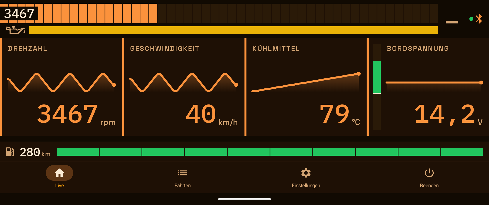
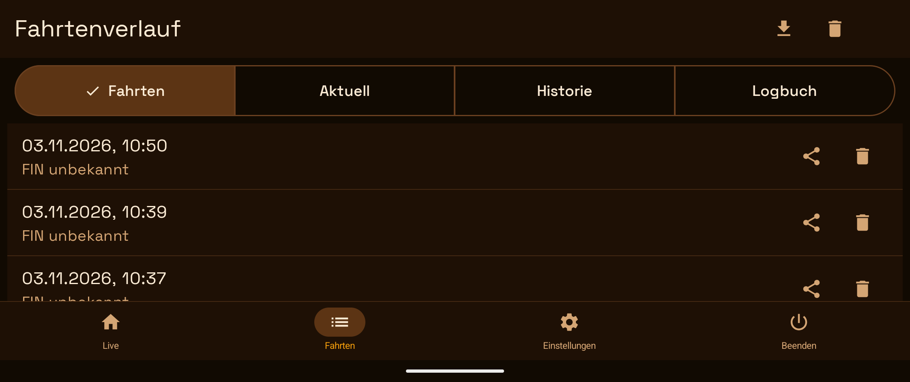
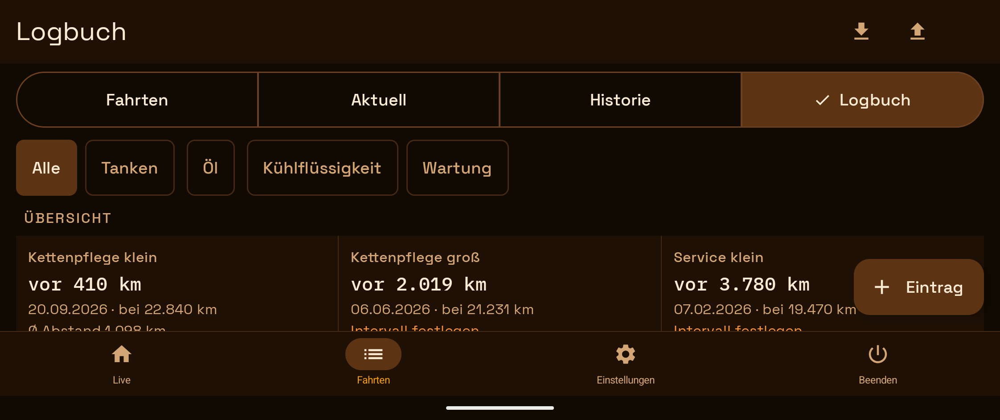
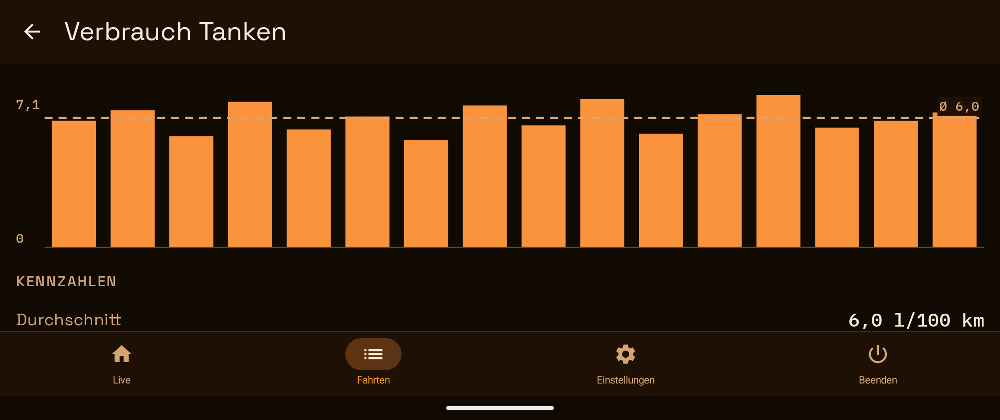

# OBD Dashboard

Ausführliche Fassung auf Deutsch · [English version](README.en.md) · [Kurzfassung / Short version](../README.md)

**OBD Dashboard** ist eine Android-App, die **Fahrt- und OBD-Daten** live als Dashboard zeigt. Ich habe sie in erster Linie für meine **KTM 990 Adventure** geschrieben (daher der Repository-Name `adv990de_obd2_dashboard`). Die OBD-Daten kommen über einen OBD2-Adapter (ELM327 über klassisches Bluetooth), die Fahrtdaten (Geschwindigkeit, Höhe, Steigung, Peilung) vom GPS und Drucksensor des Handys. Sie liest Live-Sensordaten, zeigt Fehlercodes (DTCs), speichert Fahrt-Sessions lokal und visualisiert konfigurierbare Dashboards in Jetpack Compose.

> Aktuelle Version: **1.45.3** (versionCode 162) · minSdk **26** (Android 8.0) · targetSdk **37** (Android 17) · compileSdk **37**

---

## Auf einen Blick

- **Was:** Live-Dashboard für Fahrt- und OBD-Daten, entwickelt für meine **KTM 990 Adventure**: Drehzahl, Geschwindigkeit, Temperaturen und Spannung als Kacheln, Fehlercodes lesen, Fahrten und ein Wartungslogbuch lokal speichern, virtuelle Gang- und Tankanzeige.
- **Rein lesend:** Die App liest nur (OBD2-Modi 01, 02, 03, 07, 09) und schreibt nie ins Fahrzeug — kein Löschen von Fehlern, keine Codierung.
- **Hardware:** Android 8.0 oder neuer und ein ELM327-kompatibler Adapter mit **klassischem Bluetooth (SPP)**. Adapter, die nur BLE sprechen, funktionieren nicht.
- **Stand:** Ein-Personen-Projekt. Entwickelt und im Betrieb erprobt an **einer KTM 990 Adventure** mit **einem** Adapter (MWT_OBD2); andere Fahrzeuge und Adapter sind nicht getestet. Die Geräte-Tests laufen auf einem Pixel 8 Pro (Android 17); ältere Android-Versionen sind nicht am Gerät geprüft.
- **Mit KI-Hilfe entstanden:** Der Großteil des Codes, der Tests und der Dokumentation wurde mit Claude (Anthropic) in Claude Code geschrieben (die Commit-Zeilen „Co-Authored-By“ zeigen es ebenfalls). Die Anforderungen, die Entscheidungen und die Erprobung am Motorrad stammen von mir. Automatische Tests und die Prüfungen der KI ersetzen keine unabhängige Durchsicht des Codes.
- **Nicht während der Fahrt bedienen.** Einstellungen, Logbuch und Verlauf sind für den Stillstand gedacht; das Dashboard ist zum Ablesen gebaut, nicht zum Bedienen.
- **Die Anzeigen sind keine Messgeräte:** Gang, Tankanzeige und Reichweite, die „Öltemperatur“-Leiste und die Wartungsfälligkeit sind Schätzungen, aus anderen Werten errechnet (Drehzahl, GPS-Strecke, Kühlmittel, Logbuch). Es gelten der Tacho, die Reservelampe und die Wartungsvorgaben des Herstellers.
- **Keine Gewähr:** Lizenz Apache 2.0 (s. „Lizenz“), Nutzung auf eigene Verantwortung. Die App steht in keiner Verbindung zu ELM Electronics, KTM oder einem anderen Fahrzeughersteller; „ELM327“ nennt hier nur die Art des Adapters.
- **Datenschutz:** Fahrten, Logbuch und Einstellungen bleiben auf dem Gerät, bis Sie sie selbst exportieren oder teilen. Das Netz nutzt die App nur für die optionale Außentemperatur (gerundeter Standort an Open-Meteo, s. „Berechtigungen“); ohne Sentry-Schlüssel beim Bauen sendet sie keine Absturzberichte.

## Herunterladen

Die fertige APK gibt es als **GitHub-Release**: [neueste Version](https://github.com/tomjanke/adv990de_obd2_dashboard/releases/latest). Die Dateien heißen bei jeder Version gleich, deshalb bleiben diese beiden Links stabil und zeigen immer auf die neueste:

```text
https://github.com/tomjanke/adv990de_obd2_dashboard/releases/latest/download/OBD-Dashboard.apk
https://github.com/tomjanke/adv990de_obd2_dashboard/releases/latest/download/OBD-Dashboard.apk.sha256
```

- **Installieren:** `OBD-Dashboard.apk` auf dem Telefon öffnen; Android fragt einmal, ob die Installation aus dieser Quelle erlaubt sein soll. Die App aktualisiert sich nicht selbst: für ein Update das neuere Release laden und darüber installieren (das geht, solange der Signaturschlüssel derselbe bleibt). Die Voraussetzungen stehen unter „Auf einen Blick“.
- **Download prüfen** (beide Dateien im selben Ordner):

```bash
shasum -a 256 -c OBD-Dashboard.apk.sha256
```

- **Signatur:** Die APK ist mit einem Schlüssel signiert, dessen Zertifikat nur `CN=adv990de` trägt. Der SHA-256-Fingerabdruck des Zertifikats ist `3af5a6af749022a94dd56820fa25cd31eed44e19636177e1a82a4f907dd080fe`; derselbe Wert steht in `scripts/release-cert.sha256`. Prüfen lässt er sich mit `apksigner verify --print-certs OBD-Dashboard.apk` (Build-Tools des Android SDK).
- **Erprobt** ist die App nur auf einem Pixel 8 Pro (Android 17). Was sich mit jeder Version ändert, steht in den [Release Notes](../RELEASE_NOTES.md).

## Screenshots

Aufgenommen mit der Debug-App auf einem Pixel 8 Pro im Querformat (Cockpit-Schema Orange). **Die Werte kommen vom eingebauten ECU-Simulator „OBD Sim“ und aus erfundenen Logbuch-Einträgen — nicht von einem Fahrzeug.** Der Gang zeigt „–“, weil der Simulator kein GPS hat.









---

## Funktionen

- **Live-Dashboard** mit frei konfigurierbaren PID-Kacheln (Drehzahl, Geschwindigkeit, Kühlmitteltemperatur, Motorlast, Kraftstoffstand, etc.)
- **Automatische PID-Discovery** — die App fragt das Steuergerät, welche PIDs überhaupt unterstützt werden, und filtert die Live-Abfrage entsprechend
- **DTCs lesen** (Diagnostic Trouble Codes, nur lesend — die App schreibt nie ins Fahrzeug) mit menschenlesbaren Beschreibungen (37 häufige Codes, deutsch, englisch und spanisch; jeder andere Code zeigt „Unbekannter Fehlercode“ neben dem Code) und **lokaler Fehlerhistorie** (erstmals/zuletzt gesehen, auch offline; einzeln oder komplett löschbar mit 10 s „Rückgängig“)
- **Freeze Frame** — Sensorwerte zum Zeitpunkt eines gespeicherten Fehlers
- **Fahrzeug-Info** — die Fahrgestellnummer (VIN, 17 Zeichen, via Mode 09 PID 02, aus CAN-, K-Line- und J1850-Antworten dekodiert; liefert das Fahrzeug keine, steht dort „Kein VIN verfügbar“). ECU-Name und Kalibrier-IDs werden nicht gelesen.
- **Geschwindigkeit per GPS** als Rückfallebene, wenn das Fahrzeug PID 010D nicht liefert — bei Motorrädern der Normalfall; läuft auch weiter, wenn die App minimiert ist oder der Bildschirm aus ist (Dienst-Typ `location`, ohne Hintergrund-Standort)
- **Virtuelle Ganganzeige** — errechnet den eingelegten Gang aus Motordrehzahl und Geschwindigkeit (Hysterese gegen Flackern), konfigurierbar über einen eigenen Getriebe-Einstellungsbildschirm (Radumfang, Primär-/Sekundärübersetzung, Übersetzung je Gang)
- **Drehzahl als Zahl im Balken** — links im Drehzahlbalken steht die Drehzahl in ganzen Umdrehungen (wie die Drehzahl-Kachel, in der Schrift der Statuszeile, rund 26 sp), hell auf einem dunklen Fenster: in jedem Farbschema gut lesbar, auch auf dem roten Balken. Das Fenster verdeckt in der Mitte die ersten Segmente (im Querformat rund vier, im Hochformat rund zehn), oben und unten bleibt ein Streifen des Balkens sichtbar. Ohne Verbindung, bei „keine aktuellen Werte“ und während der Start-Animation steht keine Zahl da — die Animation zeigt eine Bewegung, keine Drehzahl.
- **Simulierte Öltemperatur-Leiste** — Farbstreifen (16 dp hoch, mit einer Ölkanne davor) unter der Drehzahl-Anzeige, der aus der Kühlmitteltemperatur abschätzt, ob das Motoröl wahrscheinlich noch kalt ist (Rot, ≤ 75 °C), sich aufwärmt (Gelb) oder Betriebstemperatur hat (Grün: seit 10 Minuten über 80 °C, kurze Einbrüche unter 78 °C bis zu 2 Minuten werden toleriert); solange der 10-Minuten-Timer läuft, färbt sich der gelbe Streifen anteilig von links nach rechts grün (grüner Anteil = verstrichene Zeit); grau ohne Verbindung
- **Virtuelle Tankanzeige** — ein Balken ganz unten im Dashboard (nur dort), direkt über dem Hauptmenü bzw. der Statuszeile (volle Breite, 40 dp hoch, links ein Tankstellen-Symbol), in **zehn Segmenten** (Lücke wie beim Drehzahlbalken; die Anzeige sinkt segmentweise, nicht stufenlos — ein Segment steht für ein Zehntel der Reichweite und geht erst aus, wenn dieses Zehntel verbraucht ist), der die seit dem letzten Tanken per GPS gefahrenen Kilometer gegen die hinterlegte **Reichweite bei vollem Tank** (Einstellungen → Fahrzeug, 50–1000 km) zählt: die Farbe hängt an der Zahl leuchtender Segmente: 5–10 Segmente grün, 3–4 gelb, 2 rot, das letzte Segment rot blinkend (also ab höchstens 10 % Rest); sie wechselt genau dann, wenn ein Segment erlischt. Ein langer Druck auf Symbol oder Balken setzt sie nach Rückfrage wieder auf „voll“ (nach dem Tanken). Es ist ein Streckenzähler, keine Kraftstoffmessung: kein Erkennen des Tankens, kein Verbrauch; gezählt wird nur bei verbundener Sitzung und eingeschalteter „Geschwindigkeit per GPS“. Ohne hinterlegte Reichweite gibt es die Zeile nicht. *Neu in 1.44.0:* links neben dem Balken steht die **Restreichweite als Zahl** (auf ganze Kilometer abgerundet, eine Schätzung; bis 1.44.1 auf 5 km); eine **Reserve** (Einstellungen → Fahrzeug, in km Restreichweite) erscheint als Marke im Balken, unter der die Zahl rot wird (kein Alarm, kein Ton); mit hinterlegtem **Tankinhalt** berechnet die App die Reichweite bei vollem Tank aus dem Verbrauch der letzten Voll-zu-Voll-Intervalle des Logbuchs (ab drei Intervallen, auf etwa ±20 % genau; sonst gilt die eingegebene Reichweite), und nach einer **Teiltankung** von heute fragt das Logbuch, ob die Tankanzeige um die getankte Strecke angehoben werden soll
- **Gelände-Kachel** — ein wählbarer Eintrag der Slot-Auswahl („Gelände“), der drei Werte des **Telefons** zeigt (nicht des Fahrzeugs): die **Höhe** als große Zahl, die **Steigung** als Verlauf der letzten 1000 m (Graph mit Nulllinie, daneben der aktuelle Wert) und die **Peilung** als Windrose (Nord oben fest, die Nadel zeigt die Fahrtrichtung, darunter Himmelsrichtung und Grad). Die Höhe kommt aus dem Drucksensor, kalibriert gegen die GPS-Höhe (ohne Sensor: geglättete GPS-Höhe), die Steigung aus der Druckänderung über mindestens 100 m Fahrstrecke, die Peilung ist der GPS-Kurs über Grund (kein Kompass; im Stand wird die letzte Peilung 30 s gehalten). Sie läuft offline, braucht keine neue Berechtigung, nur den GPS-Schalter („Geschwindigkeit per GPS“; dessen Beschreibung in den Einstellungen nennt die Kachel), und zeigt ihre Werte **auch ohne Verbindung zum Fahrzeug** — sie kommen vom Telefon. Sie rechnet nur, solange ein Slot sie trägt und das Dashboard zu sehen ist (5 s nach dem Verlassen halten GPS und Barometer an). Es wird nichts aufgezeichnet. Ohne Werte nennt der Slot den Grund (GPS aus, Berechtigung fehlt, wartet auf Signal). Nicht am Motorrad geprüft
- **Lade-/Entlade-Balken** *(seit 1.37.0)* — die Spannungs-Kachel (jede Kachel mit der Steuergerätespannung `0142`) zeigt links einen senkrechten Balken, 16 dp breit wie der Tankbalken: Skala 11–15 V, Nulllinie bei 12,7 V, gefüllt von der Nulllinie bis zur über 10 s geglätteten Spannung (Median, seit 1.44.9; vorher Mittel) — **grün** ab 13,3 V („lädt“), **gelb** von 12,7 bis unter 13,3 V („lädt kaum“), **rot** unter 12,7 V („entlädt“; im Stand mit Lüfter normal). **vor dem Start** (verbunden, Motor aus) zeigt er schon die Spannung, gleiche Lage und Farben *(seit 1.39.0)*; **beim Start und beim Abstellen entsteht keine Lücke** *(seit 1.39.1)*: das Fenster beginnt neu, der Balken zeigt ab der ersten Probe etwas (nach dem Start steigt er über einige Sekunden: das Steuergerät hält den Anlasser-Wert bis rund 4 s, der Median ignoriert ihn, sobald die Mehrheit der Proben gut ist); ohne Verbindung nur Spur und Nulllinie, gedämpft. TalkBack liest bei laufendem Motor das Zustandswort hinter dem Wert, vor dem Start nur die Zahl. Die Zahl bleibt der aktuelle Messwert. Die Grenzen stammen aus neun kühlen Fahrten und der Faustregel für die Ruhespannung einer vollen Batterie und sind am Fahrzeug nicht geprüft; eine „Lüfter läuft“-Anzeige gibt es nicht.
- **Min/Max je Fahrt** *(seit 1.38.0)* — der Detail-Dialog einer Fahrt (Tipp auf die Zeile unter „Fahrten“) zeigt hinter den Fehlercodes die **Messwerte der Fahrt**: kleinster und größter Wert von **Kühlmittel** und **Bordspannung**, zwei Zeilen unter den Spalten Min und Max, kein Diagramm. Die Werte werden aus den aufgezeichneten Messwerten gerechnet (keine neue Aufzeichnung, auch ältere Fahrten, soweit sie den Wert aufzeichneten; fehlt er, steht „–“). Das Kühlmittel zählt ungefiltert (das Minimum ist die Starttemperatur), die **Spannung nur bei laufendem Motor, ab 15 s nach dem Start** — sonst wäre das Minimum fast immer der Anlasser-Einbruch; ein Hinweis im Dialog nennt die Regel. Bei imperialen Einheiten steht das Kühlmittel in °F. Ein Lesefehler wird als solcher gemeldet, nicht als „keine Werte“. Am Fahrzeug nicht gesehen; die Spannung steht erst seit 1.36.0 auch ohne Spannungs-Kachel in der Fahrt.
- **Alarme unterwegs** *(seit 1.36.0)* — drei Alarme, alle rein lesend: **Spannung** (Steuergerätespannung `0142`, bei eingeschaltetem Alarm alle 4 Zyklen zusätzlich abgefragt und dann auch in der Fahrt aufgezeichnet), **Kühlmittel** und **neuer Fehlercode unterwegs** (die App liest Modus 03/07 alle 60 s nach, ein neuer Code zählt erst in zwei aufeinanderfolgenden Auslesungen). Ein Wert allein alarmiert nie, er muss anhalten, und nur bei laufendem Motor (die Spannung 15 s nach dem Start): Spannung unter 12,2 V ≥ 10 s = Warnung (rot), unter 12,5 V ≥ 20 s = Hinweis (gelb), unter 13,0 V ≥ 3 min = Hinweis (Entladung); Kühlmittel ab 100 °C ≥ 5 s = Warnung, ab 95 °C ≥ 10 s = Hinweis; ein neuer bestätigter Fehlercode = Warnung, ein nur ausstehender = Hinweis. Anzeige: ein **Alarmband** (mindestens 72 dp, volle Breite, größere Schrift, kein Blinken), das die Kacheln am oberen Rand **überlagert** (nichts verschiebt sich; die Werte unten bleiben sichtbar), mit dem wichtigsten Alarm und „+N“ für weitere — **ein Tipp quittiert** — und eine **Systembenachrichtigung** (eigener Kanal „Alarme“, hohe Wichtigkeit: Ton und Vibration nach Systemeinstellung, auch auf anderen Seiten und bei gesperrtem Bildschirm). Einstellungen → Alarme: drei Schalter (Standard an) und je Alarm zwei wählbare Schwellen; ein Hinweis erscheint, wenn Benachrichtigungen gesperrt sind. Ein Fehler-Alarm bleibt, bis er quittiert wird — auch wenn die Sitzung endet, solange die App geöffnet bleibt (nach „Beenden“ oder Wegwischen bleibt nur die Benachrichtigung). **Nicht am Fahrzeug geprüft** (der Simulator meldet keine Fehlercodes und löst die anderen Alarme nicht aus), die Schwellen stammen aus 9 kühlen Fahrten (Heizgriffe können den Spannungshinweis auslösen), der Ton am Lenker ist ungemessen, A9 Teil 2 (Mehrframe-Antworten) bleibt offen. Im Querformat verkleinert das Band die Kachelreihe (200 → 156 dp, mit vollem Vorschau-Band weniger). Einzelheiten: `CLAUDE.md`, Abschnitt „Alarme“
- **Datum, Uhrzeit und Außentemperatur während der Fahrt** — ist „Navigationsleiste beim Fahren ausblenden" an und das Fahrzeug in Bewegung, erscheint an Stelle des Hauptmenüs (auf jedem Screen, in exakt dessen Höhe) eine Statuszeile mit Datum/Uhrzeit und der Außentemperatur am aktuellen Standort — frei über [Open-Meteo](https://open-meteo.com/) (kein API-Key, Namensnennung UND Lizenztext CC BY 4.0 je als eigener Link unter App-Info), in °C oder °F je nach Einheiten-Einstellung. Abgefragt wird einmal pro Minute und nur, solange die Zeile sichtbar ist; ein fehlgeschlagener Abruf lässt den letzten Wert bis zu 30 Minuten stehen. Datenschutz und Berechtigung: s. [Berechtigungen](#berechtigungen)
- **Logbuch** *(seit 1.42.0)* — ein viertes Segment unter „Fahrten“ (Fahrten · Aktuell · Historie · Logbuch): Tanken, Öl und Kühlflüssigkeit nachfüllen, Kettenpflege (klein/groß), Service (klein/groß), Reifenwechsel (mit Fabrikat) und Kettenkit-Wechsel mit **Datum und Kilometerstand**, **rein lokal**. Den Kilometerstand tippt man von Hand ein (die App kennt keinen); Prüfregeln fangen Tippfehler — Stand und Datum, die sich widersprechen, ein unplausibler Preis je Liter oder Verbrauch fragen nach („Trotzdem speichern?“). Löschen wie überall mit Rückgängig; nach einer vollen Tankung von heute fragt die App, ob die Tankanzeige auf voll gesetzt werden soll. **Export und Import** über die Seite „Daten sichern und wiederherstellen“ (Speichern im Dateidialog oder Teilen, als CSV oder als Teil eines Pakets; der Import zeigt erst eine Vorschau, erkennt schon vorhandene Einträge und schreibt alles oder nichts — eine ergänzte Datei bringt nur die neuen Zeilen). **Der Export ist die einzige Sicherung:** die App legt kein Backup an (`allowBackup=false`), das Löschen der App-Daten oder Deinstallieren vernichtet das Logbuch. Ein einmaliges Skript (`scripts/logbook_convert.py`) wandelt ein vorhandenes Tankprotokoll und eine Öl-Liste in das Importformat um. **Auswertung und Erinnerungen** *(seit 1.43.0)*: über der Liste eine **Übersicht** der Wartung (je Art „vor N km“, Datum und Stand des letzten Eintrags, mittlerer Abstand) und die **Auswertung** mit Karten für Tanken (Verbrauch **Voll-zu-Voll**, Ø = Summe der Liter durch Summe der Kilometer), Öl und Kühlflüssigkeit (ml/1000 km) mit Mini-Balkendiagramm; der Filter bestimmt, welche Abschnitte oben stehen; ein Tipp auf eine Karte öffnet die Detailseite (großes Diagramm, Kennzahlen, Intervalle). In **Einstellungen → Fahrzeug → „Wartungsintervalle“** (oder per Tipp auf eine Zelle der Übersicht) legst du je Wartungsart ein Intervall in km fest — **ohne vorbelegte Werte** —, dann zeigt das Logbuch „fällig in N km“ (gelb im letzten Zehntel, rot ab der Fälligkeit), **nur im Logbuch**, ohne Band und Benachrichtigung. Der aktuelle Stand dafür ist **geschätzt**: höchster Logbuch-Stand plus per GPS gezählte Kilometer seit diesem Eintrag („ca.“); gezählt wird nur bei verbundener Sitzung und eingeschalteter GPS-Geschwindigkeit, die Schätzung ist daher meist zu niedrig. Am Fahrzeug ist nichts nötig und nichts geprüft (das Logbuch liest nichts vom Steuergerät); am Gerät getestet mit dem Pixel 8 Pro.
- **Ein Menüpunkt „Fahrten“** — Fahrtenverlauf und Fehlercodes teilen sich einen Punkt im Hauptmenü (Live, Fahrten, Einstellungen, Beenden) mit einem Umschalter „Fahrten | Aktuell | Historie“; „Aktuell“ und „Historie“ sind die beiden Ansichten der Fehlercode-Seite, der Freeze Frame bleibt ihre Unterseite
- **Fahrt-Historie** — Sessions werden in Room persistiert, mit CSV-Export (je Fahrt über das Teilen-Symbol der Zeile, oder **alle abgeschlossenen Fahrten in einer Datei** über das Export-Symbol der Kopfleiste, das die Seite „Daten sichern und wiederherstellen“ öffnet: teilen oder mit dem Dateidialog des Systems **auf dem Gerät speichern**, z. B. in Downloads); einzeln löschbar per Papierkorb oder Swipe (ohne Rückfrage, 10 s „Rückgängig“), „Alle löschen“ mit Rückfrage; die laufende Aufzeichnung bleibt immer erhalten (lokal, die App schreibt nie ins Fahrzeug). **Fahrten importieren:** das Upload-Symbol der Kopfleiste (neben dem Export) öffnet dieselbe Seite und liest eine Export-Datei (`session_all_<UTC-Zeit>.csv`, auch den Export einer einzelnen Fahrt und ältere Dateien) in die App zurück — gedacht für den Umzug aus einer älteren Installation, etwa aus der Vorgänger-App unter dem früheren Paketnamen. Der Import zeigt erst eine **Vorschau** (neue Fahrten, Messwerte, Zeitraum), überspringt Fahrten, deren Zeit eine vorhandene berührt (ein zweiter Import derselben Datei ändert nichts), und Fahrten **älter als 90 Tage** (die App würde sie beim nächsten Start löschen), nennt nicht lesbare Zeilen und schreibt erst auf „Importieren“ — **alles oder nichts**. Die Datei enthält weder FIN noch Fehlercodes: importierte Fahrten zeigen sie als „nicht erfasst“. **Fehlercodes je Fahrt:** jede neue Fahrt merkt sich die Codes, die das Fahrzeug bei ihrem Beginn meldete; die Zeile zeigt dann „N Fehler“ (rot, sobald ein bestätigter Code dabei ist, gelb bei nur ausstehenden), ein Tipp auf die Zeile öffnet die Details mit Ende, FIN und den Codes samt Beschreibung. Drei Zustände: Codes · „das Fahrzeug meldete keine“ · „nicht erfasst“ (Fahrten vor 1.33.0 und ein gescheitertes Auslesen — sie werden nicht nachträglich zugeordnet). Ein Code, der erst mitten in der Fahrt auftritt, wird nicht erfasst; „Nur Fahrten mit DTCs speichern“ ist unverändert
- **Daten sichern und wiederherstellen** — Einstellungen → Info & Wartung → „Daten sichern und wiederherstellen“ öffnet **eine Seite**, auf der Sie wählen, welche Daten exportiert, geteilt oder eingelesen werden: **Fahrten** (mit FIN und Fehlercodes, soweit erfasst), **Logbuch**, **Einstellungen**, **Zähler** (Tankanzeige und Kilometer-Schätzung des Logbuchs), **Fehlerhistorie** und **App-Log**. Ausgabe als **Paket** (eine ZIP-Datei `obd-dashboard_<UTC-Zeit>.zip` mit `manifest.json` und je Teil `trips.csv` (dazu `trips_meta.csv` für FIN und Fehlercodes), `logbook.csv`, `settings.json`, `counters.json`, `dtc_history.csv`, `applog.csv`) oder, bei genau einer der Arten Fahrten, Logbuch oder App-Log, als **dieselbe CSV-Datei wie bisher** (ohne FIN und Fehlercodes). Die Export- und Import-Symbole in Fahrten, Logbuch und App-Log führen als Abkürzungen auf dieselbe Seite. Das Einlesen erkennt die Datei selbst (Paket oder CSV nach ihrer Kopfzeile; alle früheren Export-Dateien bleiben einlesbar), zeigt eine **Vorschau je Teil** und schreibt erst auf „Importieren“ — je Teil alles oder nichts, ein gescheiterter Teil stoppt die anderen nicht; der App-Log lässt sich nur ausgeben, nie einlesen. Einstellungen werden streng geprüft: ein ungültiger Wert wird nicht übernommen (nie gerundet oder geraten), schlägt das Schreiben fehl, bekommen die berührten Einstellungen ihren alten Wert zurück. **Nicht im Paket:** der gekoppelte Adapter, Berechtigungen und der Schalter für Absturzberichte. **Die FIN im Paket ist personenbezogen — geben Sie die Datei nicht weiter.** **Die App sichert nichts von selbst:** das Löschen der App-Daten oder der App vernichtet Fahrten, Logbuch und Einstellungen — bewahren Sie die Datei außerhalb des Telefons auf. Die laufende Aufzeichnung ist nicht dabei, und ein Eintrag, der vor weniger als 10 s gelöscht wurde, kann noch in der Datei stehen. **Nicht am Gerät durchgespielt:** der Dateidialog (Speichern, Öffnen) und das Teilen-Menü sowie ein echter Umzug auf eine andere Installation (getestet ist die Runde hin und zurück im Test); die Obergrenzen des Pakets sind nicht gemessen. Einzelheiten: `CLAUDE.md`, Abschnitt „Daten sichern und wiederherstellen“
- **Foreground Service** — Verbindung bleibt im Hintergrund aktiv (persistente Benachrichtigung mit „Disconnect"-Action)
- **Connection-Backends**:
  - **Klassisches Bluetooth (RFCOMM)** — gekoppelter ELM327-Adapter (Seriell-Profil SPP). Einen BLE-Zweig gibt es seit 1.24.9 nicht mehr: Die Geräteliste hat nie BLE-Adapter angeboten (der Scan wurde nirgends aufgerufen), der Code war tot.
  - **Simulator** — synthetischer ECU für Entwicklung und UI-Tests
- **Aufbewahrung** — einmal je App-Start löscht die App lokal Fahrten, die älter als **90 Tage** sind (die laufende Fahrt nie), App-Log-Zeilen älter als **30 Tage** und alles über den neuesten **1000** Log-Zeilen. Es gibt dafür keine Rückfrage und kein „Rückgängig“; wer Fahrten länger braucht, exportiert sie vorher als CSV. Gelöscht wird nur lokal, nie im Fahrzeug. Exportierte CSV-Dateien (Cache) räumt die App nach **24 Stunden** auf. Der Fahrten-Import nimmt Fahrten, die älter als 90 Tage sind, gar nicht erst an.
- **App-Logs** — eigene Log-Persistenz (Room) mit 30-Tage-/1000-Einträge-Limit (greift beim App-Start), einsehbar im Settings-Bereich; Löschen mit Rückfrage und 10 s „Rückgängig“ (lokaler Lösch-Vertrag, nie ein Schreibzugriff aufs Fahrzeug); **Export** *(seit 1.41.0)*: ein Symbol links vom Papierkorb öffnet die Seite „Daten sichern und wiederherstellen“ mit dem App-Log vorgewählt: „Speichern“ (Dateidialog des Systems, z. B. Downloads) oder „Teilen“ (Teilen-Menü) — der Log als **eine CSV-Datei** `applog_<Zeit>.csv` mit den Spalten `timestamp,level,message` (Millisekunden UTC, älteste Zeile zuerst) oder als Teil eines Pakets. Die Datei enthält den Namen des Adapters und Fehlermeldungen; die Seite weist darauf hin
- **Material 3** UI mit drei dark-only Cockpit-Farbschemata (Blau/Amber/Grün, s. Design-Profil) sowie einem Default-Farbschema mit Hell/Dunkel/System-Wahl, deutsch, englisch und spanisch lokalisiert
- **Crash-Reporting** über Sentry — nur in einer Version, die beim Bauen einen DSN bekommen hat; dann in den Einstellungen abschaltbar („Absturzberichte senden“)

---

## Hardware-Voraussetzungen

- Android-Gerät mit **Bluetooth Classic**, ab Android 8.0 (das Manifest verlangt die Bluetooth-Hardware: `uses-feature android.hardware.bluetooth`, `required="true"`; Standort-Hardware ist optional, `required="false"`)
- **ELM327-kompatibler OBD2-Adapter mit klassischem Bluetooth (SPP)** — im Betrieb mit einem MWT_OBD2 an der KTM 990 Adventure; **BLE-only-Adapter** (z. B. Vgate iCar Pro BLE, OBDLink CX im BLE-Modus) funktionieren nicht
- Fahrzeug mit OBD2-Buchse (ab Bj. ~2001 in EU, ~1996 in US verpflichtend)

---

## Build & Run

### Voraussetzungen
- JDK **21** von JetBrains (die Daemon-JVM-Kriterien in `gradle/gradle-daemon-jvm.properties`; Android Studio bringt die JetBrains Runtime mit, auch `~/.gradle/jdks` wird gefunden). Gradle lädt **kein** JDK nach — s. „Prüfsummen“
- **Android SDK** mit der Plattform 37 (`compileSdk 37`). Android Studio legt die Datei `local.properties` mit `sdk.dir` beim Öffnen des Projekts selbst an (sie steht in der `.gitignore`); auf der Kommandozeile stattdessen die Umgebungsvariable `ANDROID_HOME` auf das SDK setzen. Fehlt die Plattform, installiert man sie mit dem SDK Manager von Android Studio.
- Android Studio Ladybug oder neuer (für Compose Preview / Layout Inspector)
- Optional: ADB im `PATH` für Command-Line-Installation

### Build
```bash
./gradlew assembleDebug
```
Das APK liegt danach unter `app/build/outputs/apk/debug/app-debug.apk`. Zum Ausprobieren und Entwickeln genügt der Debug-Build; `./gradlew assembleRelease` ohne eigenen Signaturschlüssel liefert ein **nicht signiertes** APK, das sich nicht installieren lässt (s. „Release-Build“).

Die JVM-Tests brauchen kein Gerät:
```bash
./gradlew testDebugUnitTest
```
### Auf Gerät installieren
```bash
./gradlew installDebug
```
Voraussetzung: USB-Debugging aktiviert, Gerät verbunden (`adb devices`).

### Prüfsummen (Lieferkette)
Die Gradle-Distribution ist per `distributionSha256Sum` (`gradle/wrapper/gradle-wrapper.properties`) festgelegt, Abhängigkeiten und Plugins per
`gradle/verification-metadata.xml` (SHA-256, 998 Komponenten): passt ein Artefakt nicht oder fehlt es, bricht der Build ab. **Neue oder aktualisierte
Abhängigkeit → Metadaten neu schreiben** — Befehl und Fallstrick (`--refresh-dependencies`) stehen in der [`CLAUDE.md`](../CLAUDE.md). Das JDK lädt Gradle nie von selbst herunter (`org.gradle.java.installations.auto-download=false` in `gradle.properties`): für Toolchains gibt es keine Prüfsumme, und ein unbemerkt
nachgeladenes JDK wäre ein ungeprüftes Programm im Build. Fehlt es, bricht der Build mit „No matching toolchains found“ ab; dann einmal selbst installieren oder bewusst per
`./gradlew -Porg.gradle.java.installations.auto-download=true help` nachladen.

### Debug- und Release-Build parallel

Der Debug-Build trägt `applicationIdSuffix = ".debug"` und heißt im Launcher **OBD Dashboard Debug**;
seine Version endet auf `-debug`. Beide Varianten lassen sich damit gleichzeitig installieren,
jede mit eigenen Daten — kein Deinstallieren, kein Datenverlust beim Wechsel.

Optisch unterscheiden sie sich am Launcher-Icon: Der Release-Build hat den marineblauen Hintergrund
(`#0B1B2E`), der Debug-Build ist amber (`#B45309`). Überschrieben wird dafür allein
`src/debug/res/drawable/ic_launcher_background.xml`; Vordergrund und Adaptive-Icon-Definition
bleiben gemeinsam in `src/main`, sodass beide Icons dieselbe Form behalten.

Hat der Nutzer ab Android 13 *themed icons* aktiviert, greift diese Unterscheidung nicht: Das
System verwirft dann die Hintergrundebene und tönt allein die `<monochrome>`-Ebene nach der
Wallpaper-Palette. Beide Installationen sehen dort gleich aus und sind nur am Namenszusatz
„Debug" auseinanderzuhalten.

Das ist vor allem für den **ECU-Simulator** relevant: Das virtuelle Gerät „OBD Sim" erscheint
in der Geräteliste nur, wenn `BuildConfig.DEBUG` gesetzt ist (siehe
`BluetoothDeviceScanner.bondedDevices`). Im Release-Build gibt es den Eintrag nicht — wer ohne
Fahrzeug testen will, nutzt die Debug-Variante.

---

## Release-Build

Der Release-Build wird über einen lokalen Keystore signiert. Schlüssel und Passwörter werden **nicht im Repository abgelegt**, sondern über Environment-Variablen oder `~/.gradle/gradle.properties`:

```properties
# ~/.gradle/gradle.properties (NICHT im Projekt-Ordner!)
KEYSTORE_PASSWORD=<dein-keystore-passwort>
KEY_ALIAS=<alias>
KEY_PASSWORD=<key-passwort>
SENTRY_DSN=<optional-sentry-dsn>
```

Der Keystore liegt standardmäßig als `keystore.jks` im Projekt-Root (per `.gitignore` ausgeschlossen). **Besser außerhalb des Projektbaums**
(z. B. `~/.android-keys/<name>.jks`, Ordner Modus 700, Datei Modus 600): dann `KEYSTORE_FILE=~/.android-keys/<name>.jks` in
`~/.gradle/gradle.properties` oder als Umgebungsvariable setzen (`~/` wird aufgelöst). Zeigt `KEYSTORE_FILE` ins Leere, **bricht der
Release-Build ab** (statt still ein unsigniertes APK zu bauen); ohne jede Angabe und ohne `keystore.jks` entsteht wie bisher ein unsigniertes APK.
`scripts/release.sh` verweigert den Release, wenn Keystore oder `~/.gradle/gradle.properties` für andere Benutzer lesbar sind (`chmod 600`), und
prüft, dass das APK mit dem Zertifikat aus `scripts/release-cert.sha256` signiert ist (öffentlicher SHA-256-Fingerabdruck, kein Geheimnis) — ein
falscher Schlüssel ergäbe ein Update, das sich nicht über die installierte App einspielen lässt. Wechselt der Schlüssel absichtlich (nie ohne Not:
Nutzer müssten neu installieren), den Fingerabdruck dort mit-ändern.

Release bauen:
```bash
./gradlew assembleRelease
```
Output: `app/build/outputs/apk/release/app-release.apk`

### Release-Reihenfolge

1. `appVersionCode` und `appVersionName` in `app/build.gradle.kts` erhöhen und committen:
   ```bash
   git commit -am "release: 1.9.0 (versionCode 32)"
   ```
2. Release bauen: `./gradlew assembleRelease`
3. APK auf dem Gerät installieren und kurz gegenprüfen.
4. Den Release-Commit taggen und beides pushen:
   ```bash
   git tag -a v1.9.0 -m "Release 1.9.0 (versionCode 32)"
   git push origin main v1.9.0
   ```
5. Änderungen in `RELEASE_NOTES.md` festhalten.

**Tag-Konvention:** annotierte Tags im Format `vMAJOR.MINOR.PATCH`, gesetzt auf den Release-Commit (also den Commit, aus dem das ausgelieferte APK gebaut wurde). Die Tags für 1.0 bis 1.7.0 wurden am 21.09.2026 nachträglich aus der Historie rekonstruiert; `v1.0` sitzt mangels eigenem Bump-Commit auf dem letzten Commit vor dem 1.0.1-Bump.

---

## Tests

```bash
# JVM Unit Tests (3617 Tests, < 30 Sekunden)
./gradlew :app:testDebugUnitTest

# Instrumented Tests (benötigen Gerät/Emulator)
./gradlew :app:connectedDebugAndroidTest
```

| Test-Layer | Frameworks | Anzahl |
|---|---|---|
| JVM Unit Tests | JUnit 4 + MockK + kotlinx-coroutines-test | 3617 |
| Compose UI Tests | androidx.compose.ui.test + Espresso 3.7.0 + Hilt (`HiltTestRunner`) | 956 (Navigation (jede Route des Hosts), Getriebe-Einstellungen, Dashboard, Logbuch (Liste, Eintragsseite, Dialoge, Export, Auswertung, Wartungsintervalle), Balkendiagramm, Lade-/Entlade-Balken, Drehzahl-Ziffern im Balken, Alarmband samt Dashboard-Alarme, Band „fehlende Werte“ samt Dashboard-Zuständen, Alarm-Benachrichtigung, Alarm-Einstellungen, Gelände-Kachel, Preview Banner, RpmBar, Dashboard-Rand, Slot Picker, Slot-Barrierefreiheit, Touch-Ziele, Lizenzseite, Statusleisten-Symbole, Tankanzeige samt Reichweiten-Einstellung, DTC, Settings, Theme Picker, Choice Setting, Confirm Delete Dialog, Empty State, Undo Snackbar, Swipe To Delete Row, Device Row, App Logs samt Export, App Info, Freeze Frame, Gear Ratio Field, Vehicle Info, History samt Fahrt-Details und Fahrten-Import, Fahrten-Umschalter, Rpm Threshold Section, Settings Rows, Permission Gate, Live Value Tile, Live Value Text, Bottom Nav, Section Label, Sparkline, UiText) |
| Room Integration Tests | Room in-memory + `androidx.test.ext.junit` + `MigrationTestHelper` | 84 (AppLogDao, SensorReadingDao, SessionDao, DtcHistoryDao, VehicleLogDao, AppDatabase-Migration 1→2→3→4→5→6, Datenbank-Bootstrap mit Foreign Keys, SessionRepository, Fahrten-Import) |
| End-to-End über den ECU-Simulator | echtes `ObdRepository` + `SimulatorObdConnection` | 7 (Session, Discovery, Messwert-Strom, Dashboard) |
| Service Tests | `HiltAndroidRule` + `GrantPermissionRule` | 10 (ObdForegroundService, Benachrichtigungskanal, Sitzungsende, gemerkter Dienst-Typ) |
| Test-Infrastruktur | `HiltAndroidRule` | 2 (eigener DataStore je Test) |
| Vorschauen | `runAndroidComposeUiTest` | 1 (jede der 109 `@Preview`-Funktionen wird auf dem Gerät komponiert und muss etwas zeichnen) |
| Geräte-Test der Wetter-Uhr | `AndroidJUnit4` | 2 (`elapsedRealtimeSource` gegen `SystemClock.elapsedRealtimeNanos()`) |

**Testabdeckung:** die gemessene Zeilenabdeckung je Paket steht in [`docs/qa/coverage.md`](qa/coverage.md) (mit Datum und Version der Messung). Sie wird **auf Abruf** neu gemessen, nicht bei jedem Build oder Release:

```bash
scripts/coverage.sh              # JVM- und Geräte-Tests (rund 17 Minuten, Telefon wach und entsperrt) — schreibt docs/qa/coverage.md
scripts/coverage.sh --jvm-only   # nur JVM-Tests (wenige Minuten, nur eine Untergrenze) — schreibt dorthin nichts
```

Ohne `-PcoverageReport` ändert sich am Build nichts; die Zahl sagt, welche Zeilen ein Test durchläuft, nicht, ob er sie prüft.

---

## Modulstruktur

Single-Module-App (`app/`):

```
app/src/main/java/de/adv990de/obd2/
├── MainActivity.kt              # Compose-Host
├── Obd2Application.kt           # @HiltAndroidApp
├── ObdForegroundService.kt      # Hält den Prozess am Leben (Background), beendet die Sitzung beim Wegwischen
├── ObdServiceController.kt      # Dienst starten/stoppen, Sitzung beenden — eine Stelle
├── bluetooth/                   # ClassicBtConnection, SimulatorObdConnection,
│                                # ConnectionFactory, BluetoothDeviceScanner, SimulatedEcuDispatcher
├── obd/                         # ElmController, PidRegistry, PidParser, DtcParser, UnitConverter
├── data/                        # ObdRepository (@Singleton), SessionRepository, AppPreferences (DataStore),
│                                # StartupSeed (Startwerte fürs erste Bild: Theme, Kachel-Belegung),
│   └── db/                      # Room: AppDatabase, *Dao
├── ui/                          # Compose-Screens + ViewModels
│   ├── components/              # Wiederverwendbare Composables (LiveValueText/-Tile, Sparkline, BarChart (Balkendiagramm auf dem Canvas),
│   │                            # BottomNav, AmbientStatusRow = Datum/Uhrzeit/Außentemperatur)
│   ├── dashboard/               # Live-Werte
│   ├── dtc/                     # Fehlercodes: Aktuell | Historie (lokale Fehlerhistorie)
│   ├── freezeframe/             # Snapshot-Daten
│   ├── logbook/                 # Logbuch: Liste mit Filter, Übersicht + Auswertung (Karten, Detailseite), Wartungsintervall-Dialog, Eintragsseite (Löschen mit Rückgängig)
│   ├── history/                 # Fahrtenverlauf (Papierkorb/Swipe mit Undo, Alle löschen, aktive Fahrt geschützt;
│   │                            # Fehler-Zeichen je Fahrt, Details-Dialog mit den Codes bei Fahrtbeginn)
│   ├── settings/                # gruppierte Einstellungsseite (Verbindung · Dashboard & Anzeige · Alarme · Aufzeichnung · Fahrzeug · Info),
│   │                            # App-Logs, Getriebe-/Gangverhältnisse, Drehzahl-Blinkgrenze
│   ├── vehicleinfo/             # Mode 09 (VIN etc.)
│   ├── appinfo/                 # Über-Bildschirm
│   ├── licenses/                # Open-Source-Lizenzen (Katalog + Volltexte aus den Assets)
│   ├── permission/              # Runtime-Permissions Gate
│   ├── navigation/              # Compose-Navigation
│   ├── transfer/                # Daten sichern und wiederherstellen: Seite, ViewModel, Vorschau-Bausteine
│   ├── trips/                   # Menüpunkt „Fahrten“: Umschalter Fahrten | Aktuell | Historie | Logbuch über Verlauf, DTC-Seite und Logbuch
│   ├── theme/                   # Material 3 Theme, Statusleisten-Symbole (SystemBars), System-Splash-Themes (SplashTheme)
│   └── weather/                 # WeatherViewModel (Polling nur bei sichtbarer Zeile) +
│                                # 30-Minuten-Halte-Logik (OutsideTemperatureHold)
├── transfer/                    # Daten sichern und wiederherstellen: reine Logik (Teile, Paketformat, Dateierkennung, ZIP lesen und schreiben)
├── tripimport/                  # Fahrten-Import: reine Logik (Export-Datei im Strom lesen und prüfen, kompakte Messwerte, Importplan gegen die vorhandenen Fahrten)
├── logbook/                     # Logbuch: reine Logik (Arten, Prüfregeln, Formular, Filter, CSV lesen und schreiben, Importplan; Verbrauchs- und Wartungsrechnung, Fälligkeit, Kilometerschätzung)
├── terrain/                     # Gelände-Kachel: Höhe, Steigung, Peilung (reine Schätzer, Drucksensor, Eingaben aus GPS-Fix + Druck)
├── alarm/                       # Alarme: reine Regeln (SustainedRule, EngineGate, AlarmTracker, FaultCodeWatcher), AlarmController,
│                                # AlarmNotifier (Schnittstelle) + AndroidAlarmNotifier (Kanal „Alarme“), alarmMessage
├── location/                    # GpsSpeedSource (Geschwindigkeit aus dem GPS-Fix),
│                                # CurrentLocationProvider (Standort fürs Wetter: jüngster Cache-Fix ≤ 10 min, sonst aktiver Fix)
├── weather/                     # WeatherApi/OpenMeteoApi (HTTP ohne Zusatz-Library),
│                                # WeatherRepository
├── di/                          # Hilt-Module (AppModule, CrashReporterModule, LocationModule,
│                                # WeatherModule, FuelModule, TerrainModule, AlarmModule)
└── crash/                       # CrashReporter (Sentry-Wrapper), CrashReportingController (Schalter)
```

---

## Architektur-Highlights

### `ObdRepository` als Singleton
Die zentrale Repository-Schicht ist als Hilt-`@Singleton` markiert. Foreground-Service und alle ViewModels teilen sich die gleiche Instanz, kein Service-Binding nötig.

### Foreground Service hält Verbindung
`ObdForegroundService` läuft mit `foregroundServiceType="connectedDevice|location"` und einer persistenten Notification (Antippen öffnet die App, „Trennen“ beendet die Sitzung). Die Verbindung überlebt, wenn der User die App in den Hintergrund schickt — Aufzeichnung läuft dabei weiter. Der Typ `location` wird nur angefordert, wenn „Geschwindigkeit per GPS“ an und ein Standort erteilt ist; mit ihm läuft die GPS-Geschwindigkeit auch bei ausgeschaltetem Bildschirm weiter, **ohne** die Berechtigung „Immer zulassen“ (am Pixel 8 Pro geprüft: mit dem Typ bleibt die Standort-Anmeldung nach „Home“ aktiv, ohne ihn wird sie inaktiv). Polling, Aufzeichnung und Reconnect hängen am Dashboard-ViewModel, nicht am Dienst; der Dienst hält nur den Prozess am Leben. Deshalb gilt: **die Sitzung (Verbindung + Dienst + Benachrichtigung) lebt genau so lange, wie etwas die Messwerte verbraucht.** Wird die App aus der Übersicht weggewischt oder die Activity wirklich beendet (nicht nur für eine Drehung neu erzeugt), trennt die App und beendet den Dienst — wie „Beenden“; „Zurück“ am Root ab Android 12 schickt die App nur in den Hintergrund, die Aufzeichnung läuft weiter. Start, Stopp und Beenden der Sitzung liegen in einer Klasse (`ObdServiceController`); lehnt Android den Dienststart ab (ab API 31 im Hintergrund), bleibt die Verbindung bestehen und das App-Log nennt den Grund (QS-Bericht B1/B4).

### Room mit Foreign Keys
SQLite aktiviert Foreign-Key-Constraints standardmäßig **nicht**. Die App setzt `PRAGMA foreign_keys = ON` via `RoomDatabase.Callback` in `AppModule.kt` — sonst hätte `ON DELETE CASCADE` keine Wirkung.

### PID-Discovery vor Live-Polling
Vor dem ersten Live-Polling fragt `ObdRepository.discoverSupportedPids()` per Mode 01, welche PIDs das Steuergerät überhaupt antwortet. Das Dashboard filtert die konfigurierten Slots gegen diese Menge — unbekannte PIDs werden übersprungen, RPM und Kühlmitteltemperatur werden immer abgefragt (Dashboard-Logik benötigt sie).

### Wake-Lock nur wo nötig
`FLAG_KEEP_SCREEN_ON` wird ausschließlich im Dashboard-`DisposableEffect` gesetzt — solange das Dashboard sichtbar ist — unabhängig vom Verbindungsstatus (seit v1.17.6), und er wird beim Verlassen des Dashboards wieder freigegeben. Damit bleibt der Bildschirm während der Fahrt an, ohne die ganze App permanent wach zu halten.

### Volle Displayhelligkeit im Vordergrund
`MainActivity.onResume()`/`onPause()` setzen `Window.attributes.screenBrightness` auf `1f` bzw. `BRIGHTNESS_OVERRIDE_NONE` (System-Standard) zurück — ein reines Fenster-Attribut statt einer System-Einstellung, braucht daher keine `WRITE_SETTINGS`-Berechtigung. Gilt app-weit (jeder Screen, nicht nur das Dashboard) und ausschließlich solange die App im Vordergrund ist — für Sonnenlicht-Lesbarkeit auf dem Motorrad.

### Live-Wert-Typografie
Sich ändernde Werte (RPM, Speed, Temperatur, Spannung, VIN) werden in **IBM Plex Mono** mit OpenType-`tnum`-Feature gerendert — Ziffern haben konstante Glyph-Breite, springen also beim Update nicht horizontal. Kanonisches Composable: `LiveValueText` (`ui/components/`); für ad-hoc-Verwendung gibt es `TextStyle.asLiveValue()` als Extension. Restliche UI bleibt in Space Grotesk. Beide Schriften stehen unter der SIL Open Font License 1.1; die Lizenztexte liegen in `docs/licenses/` (`IBMPlexMono-OFL.txt`, `SpaceGrotesk-OFL.txt`). Die App zeigt alle ausgelieferten Open-Source-Komponenten samt Lizenztext unter App-Info → „Open-Source-Lizenzen“ (Katalog von Hand gepflegt, `LicenseCatalogTest` zwingt jede neue direkte Abhängigkeit zu einem Eintrag; die Texte in `docs/licenses/` sind zugleich die Assets der App). Volle Design-Doku in [`CLAUDE.md`](../CLAUDE.md).

### Dashboard-Tiles & Status-Signale
Sensor-Kacheln nutzen `LiveValueTile` (`ui/components/LiveValueTile.kt`) — domain-agnostische Kachel mit Label oben links, Plex-Mono-Wert + Einheit unten rechts, optionaler Trend-Sparkline und 4 dp Status-Side-Bar. Der `TileStatus`-Enum (`Ok | Warning | Critical`) treibt die Akzentfarbe: `MaterialTheme.colorScheme.primary` (theme-getönt) für OK, `StatusColors.Warning` (`#EAB308`) und `StatusColors.Critical` (`#EF4444`) cross-theme. `SensorCard` ist der Adapter für die PID-Domäne (Einheit-Konvertierung, NaN-Handling). Status-Tokens leben in `ui/theme/StatusColors.kt`.

---

## Release-Ablauf

`scripts/release.sh` hält den Ablauf fest (und warum er so ist): **erst Version bumpen und committen, dann bauen** — das 1.23.0-APK wurde aus
einem noch nicht committeten Bump gebaut, seine eingebettete Revision war nicht die des Tags (QS-Bericht B32). Das Skript

1. prüft vorab: sauberer Arbeitsbaum, die Zeilen „Aktuelle Version“ und „Current version“ der beiden ausführlichen READMEs und der oberste Release-Notes-Eintrag nennen die Version aus `app/build.gradle.kts`, der Tag existiert noch nicht, Keystore und `~/.gradle/gradle.properties` sind nur für den Eigentümer lesbar;
2. führt die JVM-Tests aus und baut `assembleRelease`;
3. prüft, dass die im APK eingebettete Revision **HEAD** ist, die Signatur (`apksigner`) und dass das Zertifikat dem festgehaltenen Fingerabdruck entspricht;
4. archiviert `mapping.txt`, die APK-Prüfsumme und die Revision außerhalb des Repos (`$RELEASE_ARCHIVE_DIR`, Standard `~/obd2-release-archive/<version>/`; die `mapping.txt` hat ~45 MB);
5. mit `--install` installiert es auf das angeschlossene Gerät und prüft den `versionCode`.

`scripts/release.sh --check` macht nur die Vorprüfung. Der **Smoke-Test** am entsperrten Gerät ist `python3 -u scripts/smoke.py <versionName> <versionCode>`
(uiautomator: Start, Reiter, Beenden-Dialog, App-Info mit Version und Build, Logcat ohne Absturz; er prüft keinen echten Adapter und läuft im Hoch- wie im Querformat). Mit `--simulator` (Debug-Build, Berechtigungen erteilt; Paket dann `de.adv990de.obd2.debug`) prüft er zusätzlich den Datenfluss gegen den ECU-Simulator: verbinden, Werte im Dashboard, „Trennen“ und danach kein Reconnect.
**Taggen und Pushen bleiben Handarbeit** nach dem Smoke-Test: `git tag -a vX.Y.Z -m "Release X.Y.Z (versionCode N)" && git push origin main vX.Y.Z`. Der Test `ReleaseDocsConsistencyTest` hält Version und versionCode in `build.gradle.kts`, den beiden ausführlichen READMEs und
`RELEASE_NOTES.md` zusammen.

**Veröffentlichen** (öffentlich und nicht rückholbar) ist ein eigener Schritt **nach** Tag, Push und Smoke-Test; die `gh`-CLI muss angemeldet sein:

```bash
scripts/release.sh --publish --dry-run
RELEASE_PUBLISH_CONFIRM=X.Y.Z scripts/release.sh --publish
```

`--publish` baut nichts, sondern nimmt das APK des letzten Laufs. Es prüft vorab, dass der Tag lokal und bei `origin` auf denselben Commit zeigt, dass die im APK eingebettete Revision die des Tags ist (HEAD darf weiter sein), dass Prüfsumme und Zertifikat zu Archiv und Fingerabdruck passen und dass es zum Tag noch kein Release gibt. Dann legt es `OBD-Dashboard.apk` und `OBD-Dashboard.apk.sha256` unter diesen festen Namen an (Text: der Abschnitt der Version aus `RELEASE_NOTES.md` plus ein Installationsblock mit Prüfsumme und Fingerabdruck), lädt die Dateien wieder herunter und vergleicht die Prüfsumme. Ohne `RELEASE_PUBLISH_CONFIRM` verlangt es die getippte Version; `--dry-run` zeigt Dateien, Text und den `gh`-Befehl und legt nichts an.

---

## Berechtigungen

Das Manifest deklariert die folgenden Berechtigungen. **Zur Laufzeit** fragt die App nur Bluetooth und Benachrichtigungen beim Start an
(`PermissionGate`; Bluetooth ist Pflicht, Benachrichtigungen sind optional) sowie Standort erst beim Einschalten der jeweiligen Einstellung.
Die übrigen sind „normale“ Berechtigungen ohne Dialog.

| Permission | API-Range | Zweck |
|---|---|---|
| `BLUETOOTH_CONNECT` | 31+ | Verbindung zu einem gekoppelten Adapter herstellen (kein `BLUETOOTH_SCAN` seit 1.24.9: die App sucht nicht) |
| `BLUETOOTH` | ≤30 | Legacy-Bluetooth (`BLUETOOTH_ADMIN` entfiel mit dem BLE-Scan) |
| `ACCESS_FINE_LOCATION` | alle | Quelle der Geschwindigkeit (opt-in, wird erst beim Einschalten angefragt) und Standort für die Außentemperatur; für Bluetooth wird kein Standort gebraucht |
| `ACCESS_COARSE_LOCATION` | alle | zusammen mit FINE angefragt (Android 12+ lässt den Nutzer zwischen genau und ungefähr wählen); genügt allein für die Außentemperatur |
| `POST_NOTIFICATIONS` | 33+ | Foreground-Service-Notification und Alarm-Benachrichtigungen (optional: ohne sie läuft der Dienst und zeigt das Dashboard die Alarme, nur die Benachrichtigungen fehlen; die Einstellungen weisen darauf hin) |
| `FOREGROUND_SERVICE` | alle | Foreground Service (normale Berechtigung, kein Dialog) |
| `FOREGROUND_SERVICE_CONNECTED_DEVICE` | 34+ | Service-Type-Required ab Android 14 (normale Berechtigung) |
| `FOREGROUND_SERVICE_LOCATION` | 34+ | Service-Typ `location`: hält die GPS-Geschwindigkeit am Laufen, solange der Adapter verbunden ist, auch bei ausgeschaltetem Bildschirm oder einer anderen App davor — **ohne** den Hintergrund-Standort („Immer zulassen“), den die App nicht deklariert (normale Berechtigung; der Typ wird nur angefordert, wenn „Geschwindigkeit per GPS“ an und ein Standort erteilt ist) |
| `INTERNET` | alle | ausschließlich die Wetterabfrage (Open-Meteo, normale Berechtigung); Sentry bleibt ohne DSN inaktiv |

**Standort für die Außentemperatur:** Genau (FINE) oder ungefähr (COARSE) genügt. Angefragt wird
beim Einschalten von „Navigationsleiste beim Fahren ausblenden" — unabhängig von „Geschwindigkeit per
GPS" (dort ist FINE Pflicht) — sowie nachträglich beim nächsten Öffnen der Einstellungen, für Nutzer
bei denen der Schalter schon aus einer früheren App-Version an ist. Dieser Nachtrag erscheint
höchstens einmal pro Installation (persistierter Guard) — kein wiederholtes
Nachfragen bei jedem weiteren Settings-Besuch.
Anders als beim GPS-Schalter folgt die Einstellung immer dem Schalter: ohne Berechtigung fehlt in der
Statuszeile nur die Temperatur, Datum und Uhrzeit bleiben. Eine schon vorher erteilte
Standortberechtigung (z. B. über den GPS-Schalter) wird mitgenutzt.
Ein vom System zwischengespeicherter Standort zählt nur, wenn er höchstens 10 Minuten alt ist (der jüngste von GPS und Netzwerk); sonst fordert die App einen
frischen Fix an, und gelingt auch der nicht, fehlt die Temperatur — lieber keine Anzeige als eine für die falsche Gegend.

**Datenschutz:** Für die Außentemperatur schickt die App die Koordinaten an einen Dritten —
Open-Meteo (`api.open-meteo.com`) —, auf zwei Nachkommastellen gerundet (rund 1,1 km; Open-Meteo
rechnet ohnehin auf einem Raster dieser Größenordnung). Das geschieht nur, solange die Statuszeile
sichtbar ist (Fahrzeug in Bewegung, Einstellung an, App im Vordergrund), dann einmal pro Minute —
und sofort, wenn die Zeile nach einer Pause von mehr als 5 Sekunden wieder erscheint.
Dafür deklariert die App `INTERNET` (normale Berechtigung, kein Dialog; das Sentry-SDK bringt sie
ohnehin schon mit). Die Anfrage nennt die App im `User-Agent` (`OBD2Monitor/<Version>`, sonst nichts —
keine Geräte- oder Nutzerkennung), und die Antwort wird höchstens 16 KiB weit gelesen (die echte ist rund
400 Byte groß): ein fehlerhafter oder bösartiger Server kostet die App weder Speicher noch Daten.

---

## Konfiguration

### Sentry (optional)
Ist beim Bauen die Env-Variable bzw. Gradle-Property `SENTRY_DSN` gesetzt (Manifest-Placeholder in `app/build.gradle.kts`), kann die App Fehlerberichte an Sentry senden. **Ohne DSN ist Sentry nicht aktiv** (kein Netzwerktraffic, auch kein Schalter in der App) — so sind die bisherigen Releases gebaut.

Mit DSN gilt zur Laufzeit: Sentry startet **nicht von selbst** (`io.sentry.auto-init=false`), sondern erst, nachdem die Einstellung gelesen ist; die Einstellung **„Absturzberichte senden“** (Info & Wartung, Standard an) startet und stoppt es sofort. Gesendet werden bei einem Absturz oder unerwarteten Fehler technische Fehlerdetails, Gerätemodell und Android-Version. Die App-Info zeigt, ob Absturzberichte an, aus oder in dieser Version nicht enthalten sind. Eingebunden ist nur `sentry-android-core` — ohne Native-Handler und Replay (vorher lagen `libsentry.so`/`libsentry-android.so` in drei Architekturen im APK, obwohl die App keinen eigenen Native-Code hat). Bekannte Grenze: Ein Absturz in den ersten Millisekunden nach dem Prozessstart, bevor die Einstellung gelesen ist, wird nicht gemeldet.

### CSV-Export einer Fahrt
Ein Export (Fahrten → Teilen) schreibt `session_<Fahrt>_<UTC-Zeit>.csv` in den Cache — je Export eine eigene Datei, nie eine überschriebene. Spalten: `timestamp` (Millisekunden seit 1970), `pid` (z. B. `010C`), `value` (metrisch, Punkt als Dezimaltrennzeichen), `name` (stabiler englischer PID-Name, z. B. `RPM`), `source` (`ECU`, `GPS` oder `DERIVED` = von der App berechnet), `session` (die Fahrt-ID, seit 1.34.0). Die ersten drei Spalten sind unverändert; `name`, `source` und `session` stehen hinten, damit Auswertungen nach Position weiterlaufen. `source` unterscheidet die Geschwindigkeit des Fahrzeugs von der des GPS (beide tragen die PID `010D`); bei Fahrten, die vor Version 1.25.0 aufgezeichnet wurden, bleibt das Feld leer, weil ihre Herkunft nicht bekannt ist. Der Gang steht als PID `GEAR` (Name `Gear`, `source` `DERIVED`): `1`–`6` = Gang, `0` = „N“, `-1` = nicht bestimmbar — es ist die Anzeige der Gang-Box (mit Hysterese und Halten), keine zweite Berechnung; er hängt am Radumfang und an den Übersetzungen, die zur Fahrtzeit eingetragen waren (sie werden nicht mitgespeichert), und fehlt in Fahrten vor dieser Version. Die Farbe des Ölbalkens steht entsprechend als PID `OIL_BAR` (Name `Oil bar`, `source` `DERIVED`): `0` = rot, `1` = gelb, `2` = grün, `-1` = grau (noch kein Kühlmittelwert) — die Farbe, die der Balken zeigte (mit Entprellen und Halten), nicht neu berechnet; Fahrten vor dieser Version haben sie nicht. Die Gang- und Balken-Zeilen eines Zyklus tragen dessen Zeitstempel, stehen in der Datei aber nicht zwingend direkt hinter ihm — nach Zeitstempel sortieren. Die Zeilen stehen in Aufzeichnungsreihenfolge und werden ohne Sortierlauf gestreamt (konstanter Speicher auch bei langen Fahrten). Bekannte Grenze: Excel macht beim Doppelklick-Öffnen aus der Spalte `pid` Zahlen wie `0105` → 105 (Anführungszeichen verhindern das nicht); die Spalte `name` identifiziert den Wert trotzdem, oder die Datei als Text importieren. **Alle Fahrten in einer Datei (seit 1.34.0):** das Export-Symbol der Kopfleiste im Bereich „Fahrten“ schreibt alle abgeschlossenen, sichtbaren Fahrten (nicht die laufende Aufzeichnung, nicht die im Rückgängig-Fenster ausgeblendeten) nacheinander, die älteste zuerst, in `session_all_<UTC-Zeit>.csv` — eine Kopfzeile, jede Zeile endet mit der Fahrt-ID in der Spalte `session`. Zwei Wege: **Teilen** (Teilen-Menü) oder **Speichern** (Dateidialog des Systems, Ort und Name wählt der Nutzer, vorgeschlagen wird derselbe Name; die Datei entsteht erst, wenn der Export vollständig ist, ein Lesefehler hinterlässt keine halbe Datei am Ziel). Die Datei wächst mit den Fahrten (etwa 0,7 MB je Stunde Fahrt, gemessen an 9 Fahrten mit 141 min = 1,6 MB); große Dateien nehmen nicht alle Teilen-Ziele an (E-Mail-Anhänge sind oft auf 25 MB begrenzt) — dann „Speichern“. Der Export einer einzelnen Fahrt hat dasselbe Format. **Import (zurück in die App):** das Upload-Symbol der Kopfleiste liest dieses Format. Gelesen wird nach Spaltennamen: `timestamp`, `pid` und `value` sind Pflicht, `source` und `session` optional (ohne `source` — Dateien vor 1.25.0 — ist die Herkunft unbekannt und bleibt es, ohne `session` — Dateien vor 1.34.0 — ist die ganze Datei eine Fahrt), `name` und unbekannte Spalten werden ignoriert. Beginn und Ende einer Fahrt sind der kleinste und der größte Zeitstempel ihrer Zeilen; FIN und Fehlercodes stehen nicht in der Datei und bleiben „nicht erfasst“. Jede Zeile wird geprüft (Zeitstempel ab dem Jahr 2000 und höchstens einen Tag in der Zukunft, `value` eine endliche Zahl, `pid` aus Buchstaben, Ziffern und Unterstrich bis 32 Zeichen, `source` leer oder `ECU`, `GPS`, `DERIVED`); eine abgelehnte Zeile nennt die Vorschau mit Zeile und Spalte, die übrigen werden importiert. Die Zeilen einer Fahrt müssen zusammenstehen (so schreibt der Export sie; sonst gilt die Datei als nicht von dieser App). Grenzen: 256 MB und 4 Millionen Zeilen (auf einem Telefon mit weniger Arbeitsspeicher für Apps entsprechend weniger; gemessen auf dem Pixel 8 Pro). Die Exportseite warnt vor, sobald die Fahrten 80 % dieser Grenze erreichen, und warnt, wenn sie darüber liegen; der Export bleibt möglich. Die Datei wird im Strom gelesen (nie als ganzer Text im Speicher), die Messwerte liegen bis zur Bestätigung kompakt im Speicher (rund 15 Byte je Zeile) und gehen in **einer Transaktion** in die Datenbank — alles oder nichts; ein langer Import sperrt die Datenbank für andere Schreiber, eine laufende Aufzeichnung wartet dann (150 000 Zeilen dauerten auf dem Pixel 8 Pro 2,3 s). **Batterie-Kennwerte aus dem Export:** `python3 -I scripts/battery_baseline.py <csv>` rechnet je Fahrt die Spannung bei „Zündung an“, den Anlasser-Einbruch (die tiefste erfasste Probe, kein Messwert der Spitze), die Ladespannung bei laufendem Motor und die Standzeit davor; die Basis vom 2026-10-19 steht in `docs/qa/2026-10-19-battery-baseline.md`. Die Spannung ist die des Steuergeräts, nicht die der Klemme — eine Aussage zur Batteriegesundheit braucht ein Multimeter.

### Benutzerseitige Einstellungen
Persistiert via Jetpack DataStore; eine Seite, gruppiert wie in der App:
- **Verbindung:** gekoppeltes Gerät (Auto-Connect zum letzten Gerät), „Alle gekoppelten Geräte“ anzeigen, Reconnect bei eingefrorenen Werten (OBD-Watchdog), Reconnect-Basisverzögerung
- **Dashboard & Anzeige:** Farbschema (drei Cockpit-Schemata plus Standard mit Hell/Dunkel/System), Einheiten (metrisch/imperial), Navigationsleiste beim Fahren ausblenden (an ihrer Stelle Datum, Uhrzeit und Außentemperatur), Geschwindigkeit per GPS (wenn das Fahrzeug keine liefert), Drehzahl-Blinkgrenze mit dynamischer Schwelle, Getriebe (Radumfang, Primär-/Sekundärübersetzung, Übersetzung je Gang für die virtuelle Ganganzeige)
- **Aufzeichnung:** „Nur Fahrten mit DTCs speichern“. Gespeichert wird, was die App abfragt: die Werte der Kacheln (zur Auswahl stehen nur Werte, die das Steuergerät als unterstützt meldet), immer Drehzahl und Kühlmittel und die Geschwindigkeit — vom Fahrzeug, wenn es sie meldet, sonst per GPS („Geschwindigkeit per GPS“) — und der **angezeigte Gang** (1–6, „N“ als 0, nicht bestimmbar als −1; Herkunft `DERIVED`, je OBD-Zyklus eine Zeile, auch wenn die Gang-Box „–“ zeigt) sowie die **angezeigte Farbe des Ölbalkens** (0 = rot, 1 = gelb, 2 = grün, −1 = grau; PID `OIL_BAR`, ebenfalls `DERIVED`, je OBD-Zyklus eine Zeile). Bei eingeschaltetem Spannungsalarm (seit 1.36.0) kommt die **Spannung** (`0142`) alle 4 Zyklen dazu, auch ohne Kachel, sofern das Steuergerät sie meldet. Mehr Werte in einer Fahrt: als Kachel belegen
- **Alarme:** Spannungsalarm, Kühlmittelalarm, „Fehler unterwegs melden“ (je ein Schalter, Standard an); je Alarm zwei wählbare Schwellen, nur sichtbar, solange der Schalter an ist: Spannung Hinweis unter 12,3 / **12,5** / 12,8 V und Warnung unter 11,8 / 12,0 / **12,2** V, Kühlmittel Hinweis ab 92 / **95** / 98 °C und Warnung ab **100** / 105 / 110 °C (Kühlmittel immer in °C, auch bei imperialen Einheiten); ein Hinweis mit Knopf zu den App-Einstellungen, wenn Benachrichtigungen gesperrt sind (nicht erkannt wird ein nur stummgeschalteter Kanal „Alarme“); die Spannung wird nach dem Einschalten ab der nächsten Verbindung mitgelesen
- **Fahrzeug:** Reichweite bei vollem Tank (für die Tankanzeige), Tankinhalt (die Reichweite wird dann aus dem Logbuch berechnet), Reserve (Marke in der Tankanzeige), Wartungsintervalle (für die Erinnerungen im Logbuch, ohne Vorgabe), Fahrzeuginfo (FIN)
- **Info & Wartung:** „Daten sichern und wiederherstellen“, „Absturzberichte senden“ (nur in einer Version mit eingebautem Sentry-DSN), App-Logs, App-Info (zeigt u. a. den Stand der Absturzberichte; von dort die Open-Source-Lizenzen)
- Die Dashboard-Slot-Belegung (welche PIDs in welche Kachel) steht ebenfalls im DataStore und wird per Long-Press auf eine Kachel geändert.

Zu den beiden Zeitwerten der Verbindung:
- **OBD-Watchdog:** nach wie vielen Sekunden ohne erfolgreiche Messung ein Reconnect erzwungen wird, sobald der Adapter gar nicht mehr (Timeout) oder nur noch unverwertbar antwortet; reines NO DATA (z. B. Zündung aus) löst ihn nie aus und startet die Frist neu — Auswahl 10 / 20 / 30 / 60 / 120 s, Standard 20 s. **Dieselbe Zeit gilt für eingefrorene Werte** *(seit der Umsetzung vom 2026-10-20, noch nicht released)*: antwortet das Fahrzeug weiter, aber bei laufendem Motor seit mindestens 12 Zyklen *(bis 1.44.6: 20)* und dieser Zeit mit genau denselben Werten, verbindet die App einmal neu (App-Log mit Rohantworten und Adapterspannung); ist es danach wieder dasselbe — *seit 1.44.7 schon beim ersten Zyklus nach dem Neuverbinden, auch nach einem Neuverbinden von Hand* —, zeigt sie „Werte eingefroren“ statt der Zahlen, bis sich ein Wert bewegt. *(Seit der Umsetzung vom 2026-10-24, noch nicht released: das Band ist gelb, mindestens 56 dp hoch und erscheint sofort statt erst nach 10 s; schon beim Neuverbinden steht „Werte eingefroren · verbinde neu 1/5“; die GPS-Geschwindigkeit wird in diesem Zustand weiter angezeigt und aufgezeichnet, und die Tankanzeige zählt weiter.)* Am Fahrzeug nicht geprüft, die Ursache des Einfrierens ist offen (`CLAUDE.md`, „Eingefrorene Werte erkennen“) (früher frei eingegebene Werte werden beim Lesen auf die nächste Auswahl gesetzt, z. B. 45 s → 60 s)
- **Reconnect-Basisverzögerung:** Wartezeit vor dem ersten Reconnect-Versuch, jeder weitere verdoppelt sie (5 Versuche) — Auswahl 3 / 10 / 30 s, Standard 3 s; die Einstellungen zeigen die resultierenden Wartezeiten (z. B. 3 · 6 · 12 · 24 · 48 s, insgesamt 1:33 min)

Die Getriebe-Eingaben haben plausible Grenzen (z. B. Radumfang 1000–4000 mm; „2.096“ wird abgelehnt statt als 2,096 mm gespeichert); `0` bei einem Gang schaltet ihn ab, falls das Getriebe weniger Gänge hat.

Die Fehlercode-Seite behauptet nur „Keine Fehlercodes“, wenn das Steuergerät positiv geantwortet hat; bleibt die Antwort aus (NO DATA) oder meldet der Adapter einen Busfehler, sagt sie das, mit „Erneut versuchen“.

„In Bewegung“ heißt: ab 5 km/h, bis die Geschwindigkeit unter 3 km/h fällt — GPS-Rauschen im Stand schaltet das Hauptmenü nicht um. Liefert das Steuergerät bei bestehender Verbindung 10 s lang keinen Messwert (z. B. Zündung aus), zeigen die Kacheln „--“ und das Band „Keine aktuellen Werte“ statt alter Zahlen *(seit der Umsetzung vom 2026-10-24, noch nicht released: ein gelbes Band, mindestens 56 dp hoch; die Geschwindigkeits-Kachel zeigt in diesem Zustand die GPS-Geschwindigkeit)*.

Fehlt die Standortberechtigung (entzogen, „Nur dieses Mal“ abgelaufen oder nur „ungefähr“ erteilt), steht unter dem GPS-Schalter und unter „Navigationsleiste beim Fahren ausblenden“ ein Hinweis mit Knopf zu den App-Einstellungen; wird sie dort erteilt, läuft GPS-Speed ohne Neustart an. Nach dem Verbinden zeigt das Dashboard sofort „Verbunden · warte auf Werte“.

Trennt der Nutzer selbst („Trennen“ in der Benachrichtigung oder den Einstellungen, „Beenden“), verbindet die App nicht von selbst wieder — auch nicht, wenn gerade eine Wiederverbindung läuft; sie bricht dann sofort ab. Nur ein verlorener Link löst Wiederverbindungs-Versuche aus.

Ist die Einstellungsdatei beschädigt oder nicht lesbar, startet die App mit den Standardwerten (statt bei jedem Start abzustürzen); die bisherigen Einstellungen gehen dann verloren.

---

## Lokalisierung

- Deutsch (`values-de/`)
- Spanisch (`values-es/`)
- Englisch (`values/`) — Standardsprache und Fallback für jede andere Sprache

**Welche Sprache die App zeigt, bestimmt allein die Systemsprache des Geräts** (Android wählt `values-de/`, `values-es/` oder `values/`; es gibt keine Sprachauswahl in der App). Datum, Uhrzeit und Zahlen folgen ebenfalls der Gerätesprache, unabhängig von den Texten.

**Bewusst nicht übersetzt:** die Meldungen im App-Log (englisch, auch im Export), die technische Meldung einer unbekannten Ausnahme (Text des Systems), die Spaltenköpfe und PID-Namen der CSV-Dateien und die Einheitenkürzel.

Die spanischen Texte hat Claude übersetzt (2026-11-02); sie sind nicht von einer muttersprachlichen Person gegengelesen. `StringResourcesParityTest` hält alle Sprachen gleich vollständig: dieselben Texte und Mengenformen, dieselben Platzhalter, nichts Unübersetztes (Ausnahmen stehen in der Liste des Tests).

**Die READMEs** gibt es als Kurzfassung (`README.md`, Englisch und Deutsch in einer Datei) und als ausführliche Fassungen auf Englisch (`docs/README.en.md`) und Deutsch (`docs/README.de.md`).

Alle UI-Strings werden über `stringResource()` resolved. ViewModels nutzen die `UiText`-Sealed-Klasse, damit Texte testbar bleiben (kein direkter `Context`-Zugriff).

---

## Tech-Stack

| Bereich | Bibliothek / Version |
|---|---|
| Sprache | Kotlin 2.4.21 |
| Build | Android Gradle Plugin 9.5.0 (built-in Kotlin) · Gradle 9.8.2 · KSP 2.3.13 |
| UI | Jetpack Compose (BOM 2026.09.00, Compose 1.12.x) · Material 3 (1.4.0) · Material Icons 1.7.8 (explizit) |
| Typografie | Space Grotesk (UI-Text) · IBM Plex Mono (Live-Werte, tabular numerals) |
| Navigation | androidx.navigation:navigation-compose 2.10.2 |
| DI | Hilt 2.60.1 |
| Persistenz | Room 2.8.5 (mit Paging-3-Integration) · DataStore Preferences 1.3.0 |
| Coroutines | kotlinx-coroutines 1.11.0 |
| Lifecycle | androidx.lifecycle 2.11.0 |
| Crash-Reporting | Sentry Android 8.62.0 |
| Tests | JUnit 4 · MockK 1.14.11 · Compose UI Test · Room Testing · Hilt Testing |

---

## Mitwirken und Sicherheit

Fehler melden und Ideen vorschlagen: als Issue (GitHub bietet je ein Formular an); **Pull Requests nur nach Absprache im Issue** — Regeln in [`CONTRIBUTING.md`](../CONTRIBUTING.md), Umgangsregeln im [`CODE_OF_CONDUCT.md`](../CODE_OF_CONDUCT.md). Sicherheitslücken **nicht** öffentlich melden, sondern privat über GitHub („Report a vulnerability“, Reiter „Security“) — s. [`SECURITY.md`](../SECURITY.md).

Die JVM-Tests laufen bei jedem Push auf `main` und jedem Pull Request in GitHub Actions (`.github/workflows/jvm-tests.yml`; die Geräte-Tests brauchen ein Telefon und laufen dort nicht).

## Lizenz

Der Quelltext steht unter der **Apache License 2.0** (`LICENSE`, Copyright 2026 adv990de, `NOTICE`). Die ausgelieferten Bibliotheken, die beiden Schriften (Space Grotesk, IBM Plex Mono: SIL Open Font License 1.1) und die Wetterdaten von Open-Meteo (CC BY 4.0) behalten ihre eigenen Lizenzen; die Texte liegen in `docs/licenses/`, die App zeigt sie unter App-Info → „Open-Source-Lizenzen“. Die sieben Symbole in `AppIcons.kt` stammen aus den Material Icons (Apache License 2.0, Google). Die Ölkanne (`ic_oil_can.xml`) ist selbst gezeichnet, nach dem gemeinfreien Öldruck-Symbol „Kontrollleuchte Oeldruck.svg“ (Wikimedia Commons, Urheber chris828).

## Namen und Marken

Die Namen Dritter stehen nur beschreibend im Text: **ELM327** ist eine Produktbezeichnung der Firma ELM Electronics und nennt hier die Art des Adapters; **OBDLink**, **Vgate** und **MWT_OBD2** sind Namen von Adaptern als Beispiele bzw. der Bluetooth-Name des Adapters, an dem die App entwickelt wurde; **KTM** und **990 Adventure** nennen den Motorradhersteller und das Motorrad, an dem die App entwickelt wurde; **Android**, **Pixel** und die **Material**-Bausteine gehören Google; **Open-Meteo** und **Sentry** sind Dienste bzw. Bibliotheken Dritter. **DMD²** (Thork Racing) war die Anregung für die Optik des Dashboards — es stammen kein Quelltext, keine Bilder und keine Schriften von dort. Die App steht in keiner Verbindung zu diesen Firmen oder Produkten.

## Release-Historie

Siehe [`RELEASE_NOTES.md`](../RELEASE_NOTES.md) — chronologische Änderungen seit Version 1.0.

---

## Verzeichnis-Konventionen

| Pfad | Inhalt |
|---|---|
| `README.md`, `docs/README.en.md`, `docs/README.de.md` | Die Kurzfassung (Englisch und Deutsch) und die ausführlichen Fassungen auf Englisch und Deutsch; die beiden ausführlichen haben dieselbe Gliederung (`ReadmeParityTest`), die Version steht nur dort |
| `app/src/main/` | Produktiv-Code |
| `app/src/test/` | JVM-Unit-Tests (3617) |
| `app/src/androidTest/` | Instrumented Tests (956, Hilt + Compose + Room) |
| `app/schemas/` | **Im Repo** — Room-Schema-Exports für Migrationstests |
| `docs/qa/` | Die gemessene Testabdeckung (`coverage.md`) und die Batterie-Basis für F12 (`2026-10-19-battery-baseline.md`; das wiederkehrende, getestete Skript liegt unter `scripts/battery_baseline.py`) — die aufgezeichneten Fahrten (CSV) liegen nicht im Repo |
| *(nicht im Repository)* | Pläne, Spezifikationen, QS-Bericht, Entscheidungsprotokoll und Auswertungen aufgezeichneter Fahrten samt Analyse-Skripten liegen in einem privaten Ordner neben dem Repository (in Verweisen `<intern>`); die Ordner `plans/` und `superpowers/` unter `docs/` stehen in der `.gitignore`, damit dort neu angelegte Pläne nicht versehentlich im Repository landen |
| `docs/ideas/` | Funktionsideen (kein Backlog, nichts beschlossen) |
| `docs/images/` | Die Screenshots für die READMEs (Debug-App, ECU-Simulator, erfundene Logbuch-Daten, Statusleiste abgeschnitten) |
| `.github/` | Workflow für die JVM-Tests (`workflows/jvm-tests.yml`, Aktionen auf festen Commit-SHAs), Dependabot nur für diese Aktionen (`dependabot.yml`), Formulare für Fehlerberichte und Ideen (`ISSUE_TEMPLATE/`) und die Vorlage für Pull Requests (`pull_request_template.md`) |
| `SECURITY.md`, `CONTRIBUTING.md`, `CODE_OF_CONDUCT.md` | Sicherheitsmeldungen, Regeln für Fehlerberichte und Pull Requests, Umgangsregeln |
| `gradle/libs.versions.toml` | Version-Catalog (Single Source of Truth für Dependencies) |

---

## Bekannte Einschränkungen

- **Kein iOS-Port** geplant.
- **CAN-Bus direkt** wird nicht unterstützt — nur OBD2-PIDs (Mode 01, 02, 03, 07, 09) — die App liest nur und schreibt nie ins Fahrzeug (kein Mode 04).
- **Multi-Frame-Antworten** (Mode 09 VIN, langwierige DTC-Listen) werden gelesen, aber die ELM327-Adapter müssen den `AT CAF1`-Modus unterstützen.
- **Nur klassisches Bluetooth (SPP):** Ein Adapter, der ausschließlich BLE spricht, lässt sich nicht verwenden. Ein früher gespeichertes BLE-Gerät wird beim Start als unbekannt behandelt (kein Auto-Connect, das Gerät einmal neu wählen).
