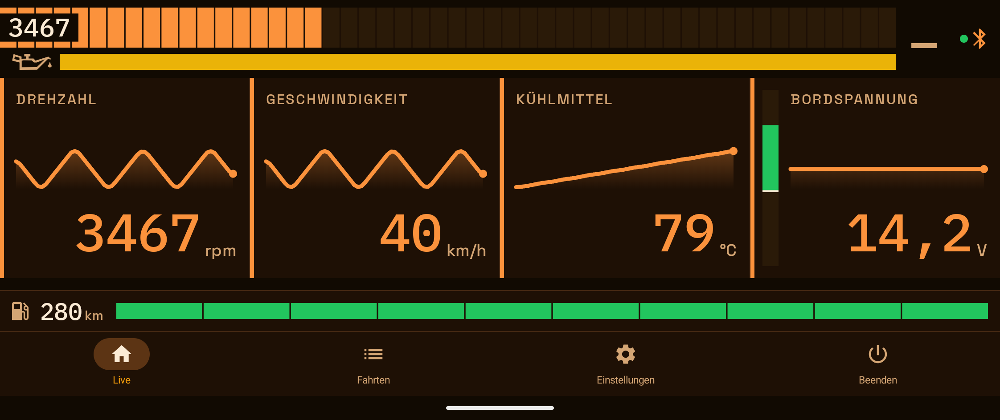
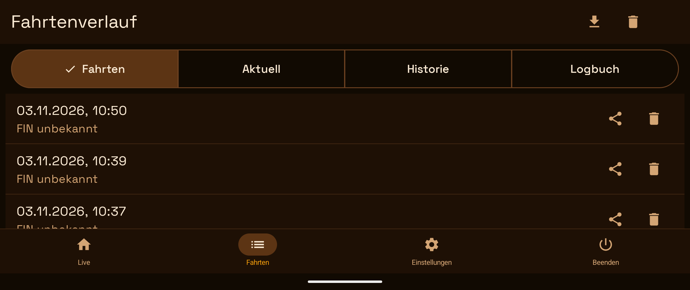
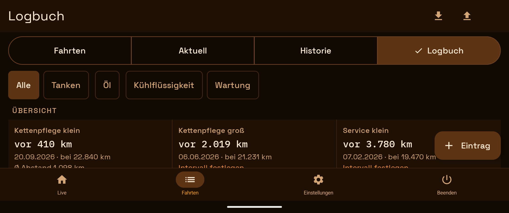
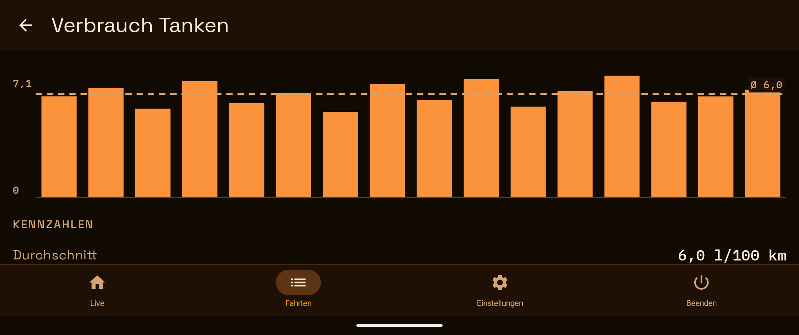

# OBD Dashboard

Detailed version in English · [Deutsche Fassung](README.de.md) · [Short version / Kurzfassung](../README.md)

**OBD Dashboard** is an Android app that shows **ride and OBD data** live as a dashboard. I wrote it first of all for my **KTM 990 Adventure** (hence the repository name `adv990de_obd2_dashboard`). The OBD data come through an OBD2 adapter (ELM327 over classic Bluetooth), the ride data (speed, altitude, gradient, heading) from the phone's GPS and pressure sensor. It reads live sensor data, shows fault codes (DTCs), stores drive sessions locally and visualises configurable dashboards in Jetpack Compose.

> Current version: **1.44.20** (versionCode 158) · minSdk **26** (Android 8.0) · targetSdk **37** (Android 17) · compileSdk **37**

---

## At a glance

- **What:** live dashboard for ride and OBD data, developed for my **KTM 990 Adventure**: RPM, speed, temperatures and voltage as tiles, reading fault codes, storing drives and a maintenance logbook locally, virtual gear and fuel gauges.
- **Read-only:** the app only reads (OBD2 modes 01, 02, 03, 07, 09) and never writes to the vehicle — no clearing of fault codes, no coding.
- **Hardware:** Android 8.0 or newer and an ELM327-compatible adapter with **classic Bluetooth (SPP)**. Adapters that only speak BLE do not work.
- **Status:** a one-person project. Developed and used in practice on **one KTM 990 Adventure** with **one** adapter (MWT_OBD2); other vehicles and adapters are untested. The device tests run on a Pixel 8 Pro (Android 17); older Android versions have not been tried on a device.
- **Written with AI assistance:** most of the code, the tests and the documentation were written with Claude (Anthropic) in Claude Code (the commit trailers "Co-Authored-By" show it too). The requirements, the decisions and the testing on the motorcycle are mine. Automated tests and the AI's own checks are no substitute for an independent review of the code.
- **Do not operate it while riding or driving.** Settings, logbook and history are meant for standstill; the dashboard is built to be read, not to be operated.
- **The displays are not measuring instruments:** gear, fuel gauge and range, the "oil temperature" strip and the maintenance due-dates are estimates derived from other values (RPM, GPS distance, coolant, logbook). The speedometer, the reserve light and the manufacturer's service schedule take precedence.
- **No warranty:** licensed under the Apache License 2.0 (see "License"), use at your own risk. The app is not affiliated with ELM Electronics, KTM or any other vehicle manufacturer; "ELM327" only names the adapter type here.
- **Privacy:** drives, logbook and settings stay on the device until you export or share them yourself. The only network use is the optional outside temperature (rounded location sent to Open-Meteo, see "Permissions"); without a Sentry key at build time the app sends no crash reports.

## Screenshots

Taken with the debug build on a Pixel 8 Pro in landscape (orange cockpit scheme). **The values come from the built-in ECU simulator "OBD Sim" and from invented logbook entries — not from a vehicle.** The gear shows "–" because the simulator has no GPS.









---

## Features

- **Live dashboard** with freely configurable PID tiles (RPM, speed, coolant temperature, engine load, fuel level, etc.)
- **Automatic PID discovery** — the app asks the control unit which PIDs it supports at all and filters the live query accordingly
- **Reading DTCs** (Diagnostic Trouble Codes, read-only — the app never writes to the vehicle) with human-readable descriptions (37 common codes, in German, English and Spanish; every other code shows "Unknown fault code" next to the code) and a **local fault history** (first/last seen, also offline; delete single entries or all of them with a 10 s "Undo")
- **Freeze frame** — sensor values at the time a fault was stored
- **Vehicle info** — the vehicle identification number (VIN, 17 characters, via mode 09 PID 02, decoded from CAN, K-Line and J1850 responses; if the vehicle returns none, it says "VIN unknown"). ECU name and calibration IDs are not read.
- **Speed from GPS** as a fallback when the vehicle does not provide PID 010D — the normal case on motorcycles; with the background permission granted it keeps running when the app is minimised
- **Virtual gear indicator** — derives the engaged gear from engine speed and road speed (hysteresis against flicker), configurable on its own gearbox settings screen (wheel circumference, primary/secondary ratio, ratio per gear)
- **RPM as digits in the bar** — on the left of the RPM bar the engine speed is shown in whole revolutions (like the RPM tile, in the font of the status row, about 26 sp), light on a dark window: easy to read in every colour scheme, also on the red bar. The window covers the first segments in the middle (about four in landscape, about ten in portrait); a strip of the bar stays visible above and below. Without a connection, with "no current values" and during the start animation no number is shown — the animation shows a movement, not an engine speed.
- **Simulated oil-temperature strip** — a colour strip (16 dp high, with an oil can in front) below the RPM display that estimates from the coolant temperature whether the engine oil is probably still cold (red, ≤ 75 °C), warming up (yellow) or at operating temperature (green: above 80 °C for 10 minutes, short dips below 78 °C of up to 2 minutes are tolerated); while the 10-minute timer runs, the yellow strip turns green proportionally from left to right (green share = elapsed time); grey without a connection
- **Virtual fuel gauge** — a bar at the very bottom of the dashboard (only there), directly above the main menu or the status row (full width, 40 dp high, a petrol-pump symbol on the left), in **ten segments** (gap as in the RPM bar; the display drops segment by segment, not continuously — one segment stands for a tenth of the range and only goes out when that tenth is used up), which counts the kilometres driven by GPS since the last refuelling against the stored **range on a full tank** (Settings → Vehicle, 50–1000 km): the colour depends on the number of lit segments: 5–10 segments green, 3–4 yellow, 2 red, the last segment red and blinking (that is, from at most 10 % left); it changes exactly when a segment goes out. A long press on the symbol or the bar resets it to "full" after a confirmation (after refuelling). It is a distance counter, not a fuel measurement: no detection of refuelling, no consumption; it only counts with a connected session and "Speed from GPS" switched on. Without a stored range the row does not exist. *New in 1.44.0:* to the left of the bar stands the **remaining range as a number** (rounded down to whole kilometres, an estimate; up to 1.44.1 to 5 km); a **reserve** (Settings → Vehicle, in km of remaining range) appears as a mark in the bar, below which the number turns red (no alarm, no sound); with a stored **tank capacity** the app calculates the range on a full tank from the consumption of the last full-to-full intervals of the logbook (from three intervals on, accurate to about ±20 %; otherwise the entered range applies), and after a **partial refuelling** of today the logbook asks whether the fuel gauge should be raised by the distance refuelled
- **Terrain tile** — a selectable entry of the slot picker ("Terrain") that shows three values of the **phone** (not of the vehicle): the **altitude** as a large number, the **gradient** as a trace of the last 1000 m (graph with a zero line, the current value beside it) and the **heading** as a compass rose (north fixed at the top, the needle shows the direction of travel, below it compass direction and degrees). The altitude comes from the pressure sensor, calibrated against the GPS altitude (without a sensor: smoothed GPS altitude), the gradient from the pressure change over at least 100 m of travel, the heading is the GPS course over ground (not a compass; at standstill the last heading is held for 30 s). It works offline, needs no new permission, only the GPS switch ("Speed from GPS"; its description in the settings names the tile), and shows its values **also without a connection to the vehicle** — they come from the phone. It only calculates while a slot carries it and the dashboard is visible (5 s after leaving, GPS and barometer stop). Nothing is recorded. Without values the slot names the reason (GPS off, permission missing, waiting for a signal). Not tried on a motorcycle
- **Charge/discharge bar** *(since 1.37.0)* — the voltage tile (every tile with the control module voltage `0142`) shows a vertical bar on the left, 16 dp wide like the fuel bar: scale 11–15 V, zero line at 12.7 V, filled from the zero line to the voltage smoothed over 10 s (median, since 1.44.9; before that the mean) — **green** from 13.3 V ("charging"), **yellow** from 12.7 to below 13.3 V ("barely charging"), **red** below 12.7 V ("discharging"; normal at standstill with the fan running). **Before the start** (connected, engine off) it already shows the voltage, same position and colours *(since 1.39.0)*; **there is no gap at the start and when the engine is switched off** *(since 1.39.1)*: the window starts anew, the bar shows something from the first sample (after the start it climbs over a few seconds: the control unit holds the starter value for up to about 4 s, the median ignores it as soon as the majority of the samples is good); without a connection only track and zero line, dimmed. TalkBack reads the state word after the value with the engine running, before the start only the number. The number remains the current measured value. The limits come from nine cool rides and the rule of thumb for the resting voltage of a full battery and have not been tried on the vehicle; there is no "fan running" indicator.
- **Min/max per drive** *(since 1.38.0)* — the detail dialog of a drive (tap on the row under "Drives") shows after the fault codes the **readings of the drive**: smallest and largest value of **coolant** and **on-board voltage**, two rows under the columns Min and Max, no chart. The values are calculated from the recorded readings (no new recording, also older drives as far as they recorded the value; if it is missing, "–" is shown). The coolant counts unfiltered (the minimum is the starting temperature), the **voltage only with the engine running, from 15 s after the start** — otherwise the minimum would almost always be the starter dip; a note in the dialog names the rule. With imperial units the coolant is shown in °F. A read error is reported as such, not as "no values". Not seen on the vehicle; the voltage has only been in the drive without a voltage tile since 1.36.0.
- **Alarms while riding** *(since 1.36.0)* — three alarms, all read-only: **voltage** (control module voltage `0142`, with the alarm switched on additionally queried every 4 cycles and then also recorded in the drive), **coolant** and **new fault code while riding** (the app re-reads modes 03/07 every 60 s, a new code only counts in two consecutive readings). A value alone never raises an alarm, it has to persist, and only with the engine running (voltage 15 s after the start): voltage below 12.2 V ≥ 10 s = warning (red), below 12.5 V ≥ 20 s = notice (yellow), below 13.0 V ≥ 3 min = notice (discharge); coolant from 100 °C ≥ 5 s = warning, from 95 °C ≥ 10 s = notice; a new confirmed fault code = warning, a merely pending one = notice. Display: an **alarm band** (at least 72 dp, full width, larger font, no blinking) that **overlays** the tiles at the top edge (nothing moves; the values below stay visible), with the most important alarm and "+N" for more — **a tap acknowledges it** — and a **system notification** (own channel "Alarms", high importance: sound and vibration according to the system settings, also on other pages and with the screen locked). Settings → Alarms: three switches (default on) and two selectable thresholds per alarm; a note appears when notifications are blocked. A fault alarm stays until it is acknowledged — also when the session ends, as long as the app stays open (after "Exit" or swiping the app away only the notification remains). **Not tried on the vehicle** (the simulator reports no fault codes and does not trigger the other alarms), the thresholds come from 9 cool rides (heated grips can trigger the voltage notice), the sound at the handlebars has not been measured, A9 part 2 (multi-frame responses) remains open. In landscape the band shrinks the row of tiles (200 → 156 dp, less with a full preview band). Details: `CLAUDE.md`, section "Alarme"
- **Date, time and outside temperature while riding** — if "Hide navigation bar while driving" is on and the vehicle is moving, a status row with date/time and the outside temperature at the current location appears in place of the main menu (on every screen, in exactly its height) — free via [Open-Meteo](https://open-meteo.com/) (no API key, attribution AND licence text CC BY 4.0 each as a separate link under App Info), in °C or °F depending on the units setting. It is queried once a minute and only while the row is visible; a failed query leaves the last value in place for up to 30 minutes. Privacy and permission: see [Permissions](#permissions)
- **Logbook** *(since 1.42.0)* — a fourth segment under "Drives" (Drives · Current · History · Logbook): refuelling, topping up oil and coolant, chain care (small/large), service (small/large), tire change (with make) and chain kit change with **date and odometer reading**, **local only**. The odometer reading is typed in by hand (the app does not know one); validation rules catch typing errors — a reading and date that contradict each other, an implausible price per litre or consumption ask back ("Save anyway?"). Deleting works as everywhere with Undo; after a full refuelling of today the app asks whether the fuel gauge should be set to full. **Export and import** via the "Back up and restore" page (saving in the file dialog or sharing, as CSV or as part of a package; the import first shows a preview, recognises entries that already exist and writes everything or nothing — an extended file brings only the new lines). **The export is the only backup:** the app makes no backup (`allowBackup=false`), deleting the app data or uninstalling destroys the logbook. A one-off script (`scripts/logbook_convert.py`) converts an existing refuelling log and an oil list into the import format. **Analysis and reminders** *(since 1.43.0)*: above the list an **overview** of the maintenance (per kind "N km ago", date and reading of the last entry, mean distance) and the **analysis** with cards for refuelling (consumption **full-to-full**, average = sum of the litres divided by sum of the kilometres), oil and coolant (ml/1000 km) with a mini bar chart; the filter decides which sections come first; a tap on a card opens the detail page (large chart, key figures, intervals). In **Settings → Vehicle → "Maintenance intervals"** (or by tapping a cell of the overview) you set an interval in km per kind of maintenance — **with no preset values** —, then the logbook shows "due in N km" (yellow in the last tenth, red from the due point), **only in the logbook**, without band and notification. The current reading for this is **estimated**: highest logbook reading plus the kilometres counted by GPS since that entry ("approx."); it only counts with a connected session and GPS speed switched on, so the estimate is usually too low. Nothing is needed on the vehicle and nothing has been tried there (the logbook reads nothing from the control unit); tested on the device with the Pixel 8 Pro.
- **One menu item "Drives"** — drive history and fault codes share one item of the main menu (Live, Drives, Settings, Exit) with a switcher "Drives | Current | History"; "Current" and "History" are the two views of the fault-code page, the freeze frame remains its sub-page
- **Drive history** — sessions are persisted in Room, with CSV export (per drive via the share symbol of the row, or **all finished drives in one file** via the export symbol of the header, which opens the "Back up and restore" page: share, or **save on the device** with the system file dialog, e.g. to Downloads); deletable one by one via the bin or by swiping (without confirmation, 10 s "Undo"), "Delete all" with confirmation; the running recording is always kept (local, the app never writes to the vehicle). **Import drives:** the upload symbol of the header (next to the export) opens the same page and reads an export file (`session_all_<UTC time>.csv`, also the export of a single drive and older files) back into the app — meant for moving from an older installation, for example from the predecessor app under the earlier package name. The import first shows a **preview** (new drives, readings, time range), skips drives whose time touches an existing one (a second import of the same file changes nothing) and drives **older than 90 days** (the app would delete them at the next start), names rows that cannot be read and only on "Import" writes — **everything or nothing**. The file contains neither VIN nor fault codes: imported drives show them as "not recorded". **Fault codes per drive:** every new drive remembers the codes the vehicle reported at its start; the row then shows "N faults" (red as soon as a confirmed code is among them, yellow if only pending ones), a tap on the row opens the details with end, VIN and the codes with description. Three states: codes · "the vehicle reported none" · "not recorded" (drives before 1.33.0 and a failed read — they are not assigned afterwards). A code that only appears in the middle of the drive is not recorded; "Only save sessions with DTCs" is unchanged
- **Back up and restore** *(phase 1, not yet released)* — Settings → Info & maintenance → "Back up and restore" opens **one page** on which you choose which data (drives, logbook, app log) is exported, shared or read in: as a **package** (a ZIP file `obd-dashboard_<UTC time>.zip` with `manifest.json` and per part `trips.csv`, `logbook.csv`, `applog.csv`) or, for exactly one kind, as **the same CSV file as before**. The export and import symbols in Drives, Logbook and App log lead to the same page as shortcuts. Reading in recognises the file by itself (package or CSV by its header line; all earlier export files stay readable), shows a **preview per part** and only on "Import" writes — everything or nothing per part, a failed part does not stop the others; the app log can only be written out, never read in. **The app backs nothing up by itself:** deleting the app data or the app destroys drives, logbook and settings — keep the file somewhere other than the phone. The recording in progress is not included, and an entry deleted less than 10 s ago can still be in the file. Settings, counters, VIN and fault history are **not yet** part of it (planned, not built). **Not tried on a device:** the file dialog (saving, opening) and the share menu; the limits of the package are not measured. Details: `CLAUDE.md`, section "Daten sichern und wiederherstellen"
- **Foreground service** — the connection stays active in the background (persistent notification with a "Disconnect" action)
- **Connection backends**:
  - **Classic Bluetooth (RFCOMM)** — paired ELM327 adapter (serial profile SPP). There has been no BLE branch since 1.24.9: the device list never offered BLE adapters (the scan was called nowhere), the code was dead.
  - **Simulator** — synthetic ECU for development and UI tests
- **Retention** — once per app start the app deletes locally drives older than **90 days** (never the running drive), app-log lines older than **30 days** and everything beyond the newest **1000** log lines. There is no confirmation and no "Undo" for this; whoever needs drives for longer exports them beforehand as CSV. Only local data is deleted, never anything in the vehicle. Exported CSV files (cache) are cleaned up by the app after **24 hours**. The drive import does not accept drives older than 90 days in the first place.
- **App logs** — own log persistence (Room) with a 30-day/1000-entry limit (applied at app start), viewable in the settings area; deleting with confirmation and 10 s "Undo" (local deletion contract, never a write access to the vehicle); **export** *(since 1.41.0)*: a symbol to the left of the bin opens the "Back up and restore" page with the app log preselected: "Save" (system file dialog, e.g. Downloads) or "Share" (share menu) — the log as **one CSV file** `applog_<time>.csv` with the columns `timestamp,level,message` (milliseconds UTC, oldest line first) or as part of a package. The file contains the name of the adapter and error messages; the page points this out
- **Material 3** UI with three dark-only cockpit colour schemes (blue/amber/green, see design profile) and a default colour scheme with a light/dark/system choice, localised in German, English and Spanish
- **Crash reporting** via Sentry — only in a build that received a DSN at build time; then it can be switched off in the settings ("Send crash reports")

---

## Hardware requirements

- Android device with **Bluetooth Classic**, from Android 8.0 (the manifest requires the Bluetooth hardware: `uses-feature android.hardware.bluetooth`, `required="true"`; location hardware is optional, `required="false"`)
- **ELM327-compatible OBD2 adapter with classic Bluetooth (SPP)** — used in practice with an MWT_OBD2 on the KTM 990 Adventure; **BLE-only adapters** (e.g. Vgate iCar Pro BLE, OBDLink CX in BLE mode) do not work
- Vehicle with an OBD2 socket (mandatory from about model year 2001 in the EU, about 1996 in the US)

---

## Build & Run

### Prerequisites
- JDK **21** from JetBrains (the daemon JVM criteria in `gradle/gradle-daemon-jvm.properties`; Android Studio ships the JetBrains Runtime, `~/.gradle/jdks` is found as well). Gradle does **not** download a JDK — see "Checksums"
- **Android SDK** with platform 37 (`compileSdk 37`). Android Studio creates the file `local.properties` with `sdk.dir` itself when the project is opened (it is in the `.gitignore`); on the command line set the environment variable `ANDROID_HOME` to the SDK instead. If the platform is missing, install it with the SDK Manager of Android Studio.
- Android Studio Ladybug or newer (for Compose Preview / Layout Inspector)
- Optional: ADB in the `PATH` for command-line installation

### Build
```bash
./gradlew assembleDebug
```
The APK is then at `app/build/outputs/apk/debug/app-debug.apk`. The debug build is enough for trying out and developing; `./gradlew assembleRelease` without your own signing key produces an **unsigned** APK that cannot be installed (see "Release build").

The JVM tests need no device:
```bash
./gradlew testDebugUnitTest
```
### Install on a device
```bash
./gradlew installDebug
```
Prerequisite: USB debugging enabled, device connected (`adb devices`).

### Checksums (supply chain)
The Gradle distribution is pinned by `distributionSha256Sum` (`gradle/wrapper/gradle-wrapper.properties`), dependencies and plugins by
`gradle/verification-metadata.xml` (SHA-256, 998 components): if an artifact does not match or is missing, the build fails. **A new or updated
dependency → rewrite the metadata** — the command and the pitfall (`--refresh-dependencies`) are in [`CLAUDE.md`](../CLAUDE.md). Gradle never downloads the JDK on its own (`org.gradle.java.installations.auto-download=false` in `gradle.properties`): there is no checksum for toolchains, and an unnoticed
downloaded JDK would be an unchecked program in the build. If it is missing, the build fails with "No matching toolchains found"; then install it yourself once or deliberately fetch it with
`./gradlew -Porg.gradle.java.installations.auto-download=true help`.

### Debug and release build side by side

The debug build carries `applicationIdSuffix = ".debug"` and is called **OBD Dashboard Debug** in the launcher;
its version ends in `-debug`. Both variants can therefore be installed at the same time,
each with its own data — no uninstalling, no data loss when switching.

They differ visually in the launcher icon: the release build has the navy blue background
(`#0B1B2E`), the debug build is amber (`#B45309`). Only
`src/debug/res/drawable/ic_launcher_background.xml` is overridden for this; the foreground and the adaptive-icon definition
stay shared in `src/main`, so both icons keep the same shape.

If the user has enabled *themed icons* from Android 13 on, this distinction does not apply: the
system then discards the background layer and tints only the `<monochrome>` layer according to the
wallpaper palette. Both installations look the same there and can only be told apart by the name suffix
"Debug".

This matters above all for the **ECU simulator**: the virtual device "OBD Sim" appears
in the device list only if `BuildConfig.DEBUG` is set (see
`BluetoothDeviceScanner.bondedDevices`). The release build does not have the entry — whoever wants to test without a
vehicle uses the debug variant.

---

## Release build

The release build is signed with a local keystore. Key and passwords are **not stored in the repository** but come through environment variables or `~/.gradle/gradle.properties`:

```properties
# ~/.gradle/gradle.properties (NOT in the project folder!)
KEYSTORE_PASSWORD=<your-keystore-password>
KEY_ALIAS=<alias>
KEY_PASSWORD=<key-password>
SENTRY_DSN=<optional-sentry-dsn>
```

By default the keystore is `keystore.jks` in the project root (excluded by `.gitignore`). **Better outside the project tree**
(e.g. `~/.android-keys/<name>.jks`, folder mode 700, file mode 600): then set `KEYSTORE_FILE=~/.android-keys/<name>.jks` in
`~/.gradle/gradle.properties` or as an environment variable (`~/` is resolved). If `KEYSTORE_FILE` points nowhere, **the
release build aborts** (instead of silently building an unsigned APK); with no setting at all and no `keystore.jks` an unsigned APK is built as before.
`scripts/release.sh` refuses the release if the keystore or `~/.gradle/gradle.properties` are readable by other users (`chmod 600`), and
checks that the APK is signed with the certificate from `scripts/release-cert.sha256` (public SHA-256 fingerprint, no secret) — a
wrong key would produce an update that cannot be installed over the installed app. If the key changes on purpose (never without need:
users would have to reinstall), change the fingerprint there as well.

Build the release:
```bash
./gradlew assembleRelease
```
Output: `app/build/outputs/apk/release/app-release.apk`

### Release order

1. Raise `appVersionCode` and `appVersionName` in `app/build.gradle.kts` and commit:
   ```bash
   git commit -am "release: 1.9.0 (versionCode 32)"
   ```
2. Build the release: `./gradlew assembleRelease`
3. Install the APK on the device and check it briefly.
4. Tag the release commit and push both:
   ```bash
   git tag -a v1.9.0 -m "Release 1.9.0 (versionCode 32)"
   git push origin main v1.9.0
   ```
5. Record the changes in `RELEASE_NOTES.md`.

**Tag convention:** annotated tags in the format `vMAJOR.MINOR.PATCH`, set on the release commit (that is, the commit the delivered APK was built from). The tags for 1.0 to 1.7.0 were reconstructed from the history afterwards on 21.09.2026; `v1.0` sits on the last commit before the 1.0.1 bump because it has no bump commit of its own.

---

## Tests

```bash
# JVM unit tests (3354 tests, < 30 seconds)
./gradlew :app:testDebugUnitTest

# Instrumented tests (need a device/emulator)
./gradlew :app:connectedDebugAndroidTest
```

| Test layer | Frameworks | Count |
|---|---|---|
| JVM unit tests | JUnit 4 + MockK + kotlinx-coroutines-test | 3354 |
| Compose UI tests | androidx.compose.ui.test + Espresso 3.7.0 + Hilt (`HiltTestRunner`) | 902 (navigation (every route of the host), gearbox settings, dashboard, logbook (list, entry page, dialogs, export, analysis, maintenance intervals), bar chart, charge/discharge bar, RPM digits in the bar, alarm band with dashboard alarms, "missing values" band with dashboard states, alarm notification, alarm settings, terrain tile, preview banner, RpmBar, dashboard edge, slot picker, slot accessibility, touch targets, licence page, status bar icons, fuel gauge with range setting, DTC, settings, theme picker, choice setting, confirm-delete dialog, empty state, undo snackbar, swipe-to-delete row, device row, app logs with export, app info, freeze frame, gear ratio field, vehicle info, history with drive details and drive import, drives switcher, RPM threshold section, settings rows, permission gate, live value tile, live value text, bottom nav, section label, sparkline, UiText) |
| Room integration tests | Room in-memory + `androidx.test.ext.junit` + `MigrationTestHelper` | 84 (AppLogDao, SensorReadingDao, SessionDao, DtcHistoryDao, VehicleLogDao, AppDatabase migration 1→2→3→4→5→6, database bootstrap with foreign keys, SessionRepository, drive import) |
| End-to-end through the ECU simulator | real `ObdRepository` + `SimulatorObdConnection` | 7 (session, discovery, reading stream, dashboard) |
| Service tests | `HiltAndroidRule` + `GrantPermissionRule` | 10 (ObdForegroundService, notification channel, end of session, remembered service type) |
| Test infrastructure | `HiltAndroidRule` | 2 (own DataStore per test) |
| Previews | `runAndroidComposeUiTest` | 1 (each of the 109 `@Preview` functions is composed on the device and must draw something) |
| Device test of the weather clock | `AndroidJUnit4` | 2 (`elapsedRealtimeSource` against `SystemClock.elapsedRealtimeNanos()`) |

**Test coverage:** the measured line coverage per package is in [`docs/qa/coverage.md`](qa/coverage.md) (with date and version of the measurement). It is re-measured **on demand**, not with every build or release:

```bash
scripts/coverage.sh              # JVM and device tests (about 17 minutes, phone awake and unlocked) — writes docs/qa/coverage.md
scripts/coverage.sh --jvm-only   # JVM tests only (a few minutes, only a lower bound) — writes nothing there
```

Without `-PcoverageReport` nothing changes in the build; the number says which lines a test runs through, not whether it checks them.

---

## Module structure

Single-module app (`app/`):

```
app/src/main/java/de/adv990de/obd2/
├── MainActivity.kt              # Compose host
├── Obd2Application.kt           # @HiltAndroidApp
├── ObdForegroundService.kt      # Keeps the process alive (background), ends the session when swiped away
├── ObdServiceController.kt      # Start/stop the service, end the session — one place
├── bluetooth/                   # ClassicBtConnection, SimulatorObdConnection,
│                                # ConnectionFactory, BluetoothDeviceScanner, SimulatedEcuDispatcher
├── obd/                         # ElmController, PidRegistry, PidParser, DtcParser, UnitConverter
├── data/                        # ObdRepository (@Singleton), SessionRepository, AppPreferences (DataStore),
│                                # StartupSeed (start values for the first frame: theme, tile assignment),
│   └── db/                      # Room: AppDatabase, *Dao
├── ui/                          # Compose screens + view models
│   ├── components/              # Reusable composables (LiveValueText/-Tile, Sparkline, BarChart (bar chart on the canvas),
│   │                            # BottomNav, AmbientStatusRow = date/time/outside temperature)
│   ├── dashboard/               # Live values
│   ├── dtc/                     # Fault codes: Current | History (local fault history)
│   ├── freezeframe/             # Snapshot data
│   ├── logbook/                 # Logbook: list with filter, overview + analysis (cards, detail page), maintenance-interval dialog, entry page (deleting with undo)
│   ├── history/                 # Drive history (bin/swipe with undo, delete all, active drive protected;
│   │                            # fault marker per drive, details dialog with the codes at the start of the drive)
│   ├── settings/                # grouped settings page (Connection · Dashboard & display · Alarms · Recording · Vehicle · Info),
│   │                            # app logs, gearbox/gear ratios, RPM blink threshold
│   ├── vehicleinfo/             # Mode 09 (VIN etc.)
│   ├── appinfo/                 # About screen
│   ├── licenses/                # Open-source licences (catalogue + full texts from the assets)
│   ├── permission/              # Runtime permissions gate
│   ├── navigation/              # Compose navigation
│   ├── transfer/                # Back up and restore: page, view model, preview building blocks
│   ├── trips/                   # Menu item "Drives": switcher Drives | Current | History | Logbook over history, DTC page and logbook
│   ├── theme/                   # Material 3 theme, status bar icons (SystemBars), system splash themes (SplashTheme)
│   └── weather/                 # WeatherViewModel (polling only with a visible row) +
│                                # 30-minute hold logic (OutsideTemperatureHold)
├── transfer/                    # Back up and restore: pure logic (parts, package format, file detection, reading and writing ZIP)
├── tripimport/                  # Drive import: pure logic (read and check the export file as a stream, compact readings, import plan against the existing drives)
├── logbook/                     # Logbook: pure logic (kinds, validation rules, form, filter, reading and writing CSV, import plan; consumption and maintenance calculation, due dates, odometer estimate)
├── terrain/                     # Terrain tile: altitude, gradient, heading (pure estimators, pressure sensor, inputs from GPS fix + pressure)
├── alarm/                       # Alarms: pure rules (SustainedRule, EngineGate, AlarmTracker, FaultCodeWatcher), AlarmController,
│                                # AlarmNotifier (interface) + AndroidAlarmNotifier (channel "Alarms"), alarmMessage
├── location/                    # GpsSpeedSource (speed from the GPS fix),
│                                # CurrentLocationProvider (location for the weather: newest cached fix ≤ 10 min, otherwise an active fix)
├── weather/                     # WeatherApi/OpenMeteoApi (HTTP without an extra library),
│                                # WeatherRepository
├── di/                          # Hilt modules (AppModule, CrashReporterModule, LocationModule,
│                                # WeatherModule, FuelModule, TerrainModule, AlarmModule)
└── crash/                       # CrashReporter (Sentry wrapper), CrashReportingController (switch)
```

---

## Architecture highlights

### `ObdRepository` as a singleton
The central repository layer is marked as a Hilt `@Singleton`. The foreground service and all view models share the same instance, no service binding needed.

### Foreground service keeps the connection
`ObdForegroundService` runs with `foregroundServiceType="connectedDevice|location"` and a persistent notification (tapping it opens the app, "Disconnect" ends the session). The connection survives when the user sends the app to the background — recording continues. Polling, recording and reconnecting hang on the dashboard view model, not on the service; the service only keeps the process alive. Therefore: **the session (connection + service + notification) lives exactly as long as something consumes the readings.** If the app is swiped away from the overview or the activity really ends (not merely recreated for a rotation), the app disconnects and ends the service — like "Exit"; "Back" at the root from Android 12 only sends the app to the background, recording continues. Start, stop and end of the session live in one class (`ObdServiceController`); if Android refuses the service start (from API 31 in the background), the connection stays up and the app log names the reason (QA report B1/B4).

### Room with foreign keys
SQLite does **not** enable foreign-key constraints by default. The app sets `PRAGMA foreign_keys = ON` via `RoomDatabase.Callback` in `AppModule.kt` — otherwise `ON DELETE CASCADE` would have no effect.

### PID discovery before live polling
Before the first live polling `ObdRepository.discoverSupportedPids()` asks by mode 01 which PIDs the control unit answers at all. The dashboard filters the configured slots against this set — unknown PIDs are skipped, RPM and coolant temperature are always queried (the dashboard logic needs them).

### Wake lock only where needed
`FLAG_KEEP_SCREEN_ON` is set exclusively in the dashboard `DisposableEffect` — as long as the dashboard is visible — independent of the connection state (since v1.17.6), and it is released again when the dashboard is left. This keeps the screen on while riding without keeping the whole app awake permanently.

### Full display brightness in the foreground
`MainActivity.onResume()`/`onPause()` set `Window.attributes.screenBrightness` to `1f` or back to `BRIGHTNESS_OVERRIDE_NONE` (system default) — a pure window attribute instead of a system setting, so it needs no `WRITE_SETTINGS` permission. It applies app-wide (every screen, not only the dashboard) and only while the app is in the foreground — for legibility in sunlight on the motorcycle.

### Live-value typography
Changing values (RPM, speed, temperature, voltage, VIN) are rendered in **IBM Plex Mono** with the OpenType `tnum` feature — digits have a constant glyph width and therefore do not jump horizontally on update. Canonical composable: `LiveValueText` (`ui/components/`); for ad-hoc use there is `TextStyle.asLiveValue()` as an extension. The rest of the UI stays in Space Grotesk. Both fonts are under the SIL Open Font License 1.1; the licence texts are in `docs/licenses/` (`IBMPlexMono-OFL.txt`, `SpaceGrotesk-OFL.txt`). The app shows all delivered open-source components with their licence text under App Info → "Open-source licenses" (catalogue maintained by hand, `LicenseCatalogTest` forces every new direct dependency to have an entry; the texts in `docs/licenses/` are at the same time the assets of the app). Full design documentation in [`CLAUDE.md`](../CLAUDE.md).

### Dashboard tiles & status signals
Sensor tiles use `LiveValueTile` (`ui/components/LiveValueTile.kt`) — a domain-agnostic tile with a label at the top left, Plex Mono value + unit at the bottom right, an optional trend sparkline and a 4 dp status side bar. The `TileStatus` enum (`Ok | Warning | Critical`) drives the accent colour: `MaterialTheme.colorScheme.primary` (theme-tinted) for OK, `StatusColors.Warning` (`#EAB308`) and `StatusColors.Critical` (`#EF4444`) cross-theme. `SensorCard` is the adapter for the PID domain (unit conversion, NaN handling). Status tokens live in `ui/theme/StatusColors.kt`.

---

## Release procedure

`scripts/release.sh` records the procedure (and why it is the way it is): **first bump the version and commit, then build** — the 1.23.0 APK was built from an
uncommitted bump, its embedded revision was not that of the tag (QA report B32). The script

1. checks beforehand: clean working tree, the lines "Aktuelle Version" and "Current version" of the two detailed READMEs and the top release-notes entry name the version from `app/build.gradle.kts`, the tag does not exist yet, keystore and `~/.gradle/gradle.properties` are readable only by the owner;
2. runs the JVM tests and builds `assembleRelease`;
3. checks that the revision embedded in the APK is **HEAD**, the signature (`apksigner`) and that the certificate matches the recorded fingerprint;
4. archives `mapping.txt`, the APK checksum and the revision outside the repo (`$RELEASE_ARCHIVE_DIR`, default `~/obd2-release-archive/<version>/`; `mapping.txt` is about 45 MB);
5. with `--install` it installs on the connected device and checks the `versionCode`.

`scripts/release.sh --check` only does the pre-check. The **smoke test** on the unlocked device is `python3 -u scripts/smoke.py <versionName> <versionCode>`
(uiautomator: start, tabs, exit dialog, app info with version and build, logcat without a crash; it does not test a real adapter and runs in portrait as well as landscape). With `--simulator` (debug build, permissions granted; package then `de.adv990de.obd2.debug`) it additionally checks the data flow against the ECU simulator: connect, values in the dashboard, "Disconnect" and then no reconnect.
**Tagging and pushing stay manual work** after the smoke test: `git tag -a vX.Y.Z -m "Release X.Y.Z (versionCode N)" && git push origin main vX.Y.Z`. The test `ReleaseDocsConsistencyTest` keeps version and versionCode in `build.gradle.kts`, the two detailed READMEs and
`RELEASE_NOTES.md` together.

---

## Permissions

The manifest declares the following permissions. **At runtime** the app only asks for Bluetooth and notifications at start
(`PermissionGate`; Bluetooth is mandatory, notifications are optional) and for location only when the respective setting is switched on.
The others are "normal" permissions without a dialog.

| Permission | API range | Purpose |
|---|---|---|
| `BLUETOOTH_CONNECT` | 31+ | Connect to a paired adapter (no `BLUETOOTH_SCAN` since 1.24.9: the app does not scan) |
| `BLUETOOTH` | ≤30 | Legacy Bluetooth (`BLUETOOTH_ADMIN` went away with the BLE scan) |
| `ACCESS_FINE_LOCATION` | all | Source of the speed (opt-in, only asked for when switched on) and location for the outside temperature; Bluetooth needs no location |
| `ACCESS_COARSE_LOCATION` | all | asked for together with FINE (Android 12+ lets the user choose between precise and approximate); alone it is enough for the outside temperature |
| `ACCESS_BACKGROUND_LOCATION` | 29+ | optional, asked for once after "Speed from GPS" has been switched on: keeps the GPS speed alive while `ObdForegroundService` runs without a visible activity |
| `POST_NOTIFICATIONS` | 33+ | Foreground service notification and alarm notifications (optional: without it the service runs and the dashboard shows the alarms, only the notifications are missing; the settings point this out) |
| `FOREGROUND_SERVICE` | all | Foreground service (normal permission, no dialog) |
| `FOREGROUND_SERVICE_CONNECTED_DEVICE` | 34+ | Service type required from Android 14 (normal permission) |
| `FOREGROUND_SERVICE_LOCATION` | 34+ | Service type `location` for the GPS speed in the background (normal permission; the type is only requested when `ACCESS_BACKGROUND_LOCATION` is granted as well) |
| `INTERNET` | all | solely the weather query (Open-Meteo, normal permission); Sentry stays inactive without a DSN |

**Location for the outside temperature:** precise (FINE) or approximate (COARSE) is enough. It is asked for
when "Hide navigation bar while driving" is switched on — independent of "Speed from GPS" (where
FINE is mandatory) — and afterwards the next time the settings are opened, for users
for whom the switch is already on from an earlier app version. This follow-up appears
at most once per installation (persisted guard, the same form as for the
background-location escalation) — no repeated asking at every further visit to the settings.
Unlike the GPS switch, the setting always follows the switch: without the permission only the temperature is missing in the
status row, date and time stay. A location permission granted earlier (e.g. through the GPS switch) is used as well.
A location cached by the system only counts if it is at most 10 minutes old (the newest of GPS and network); otherwise the app requests a
fresh fix, and if that does not succeed either, the temperature is missing — better no display than one for the wrong area.

**Privacy:** For the outside temperature the app sends the coordinates to a third party —
Open-Meteo (`api.open-meteo.com`) —, rounded to two decimal places (about 1.1 km; Open-Meteo
calculates on a grid of that order of magnitude anyway). This only happens while the status row is
visible (vehicle moving, setting on, app in the foreground), then once a minute —
and immediately when the row reappears after a pause of more than 5 seconds.
For this the app declares `INTERNET` (normal permission, no dialog; the Sentry SDK brings it along
anyway). The request names the app in the `User-Agent` (`OBD2Monitor/<version>`, nothing else —
no device or user identifier), and the response is read at most 16 KiB (the real one is about
400 bytes): a faulty or malicious server costs the app neither memory nor data.

---

## Configuration

### Sentry (optional)
If the environment variable or Gradle property `SENTRY_DSN` is set at build time (manifest placeholder in `app/build.gradle.kts`), the app can send error reports to Sentry. **Without a DSN Sentry is not active** (no network traffic, not even a switch in the app) — this is how the releases so far were built.

With a DSN the following applies at runtime: Sentry does **not start on its own** (`io.sentry.auto-init=false`), only after the setting has been read; the setting **"Send crash reports"** (Info & maintenance, default on) starts and stops it immediately. On a crash or unexpected error, technical error details, device model and Android version are sent. App Info shows whether crash reports are on, off or not included in this version. Only `sentry-android-core` is included — without the native handler and replay (before, `libsentry.so`/`libsentry-android.so` in three architectures were in the APK although the app has no native code of its own). Known limit: a crash in the first milliseconds after the process start, before the setting has been read, is not reported.

### CSV export of a drive
An export (Drives → Share) writes `session_<drive>_<UTC time>.csv` to the cache — a separate file per export, never an overwritten one. Columns: `timestamp` (milliseconds since 1970), `pid` (e.g. `010C`), `value` (metric, point as decimal separator), `name` (stable English PID name, e.g. `RPM`), `source` (`ECU`, `GPS` or `DERIVED` = calculated by the app), `session` (the drive ID, since 1.34.0). The first three columns are unchanged; `name`, `source` and `session` come last so that evaluations by position keep working. `source` distinguishes the speed of the vehicle from that of the GPS (both carry the PID `010D`); for drives recorded before version 1.25.0 the field stays empty because their origin is not known. The gear is stored as PID `GEAR` (name `Gear`, `source` `DERIVED`): `1`–`6` = gear, `0` = "N", `-1` = not determinable — it is the display of the gear box (with hysteresis and holding), not a second calculation; it depends on the wheel circumference and the ratios that were entered at the time of the drive (they are not stored along), and it is missing in drives before this version. The colour of the oil bar is stored accordingly as PID `OIL_BAR` (name `Oil bar`, `source` `DERIVED`): `0` = red, `1` = yellow, `2` = green, `-1` = grey (no coolant value yet) — the colour the bar showed (with debouncing and holding), not recalculated; drives before this version do not have it. The gear and bar rows of a cycle carry its timestamp but do not necessarily stand directly behind it in the file — sort by timestamp. The rows are in recording order and are streamed without a sort pass (constant memory even for long drives). Known limit: when opened by double-click, Excel turns the column `pid` into numbers like `0105` → 105 (quotation marks do not prevent that); the column `name` identifies the value anyway, or import the file as text. **All drives in one file (since 1.34.0):** the export symbol of the header in the section "Drives" writes all finished, visible drives (not the running recording, not those hidden in the undo window) one after the other, the oldest first, to `session_all_<UTC time>.csv` — one header line, every line ends with the drive ID in the column `session`. Two ways: **Share** (share menu) or **Save** (system file dialog, the user chooses place and name, the same name is suggested; the file only comes into being when the export is complete, a read error leaves no half file at the destination). The file grows with the drives (about 0.7 MB per hour of driving, measured on 9 drives with 141 min = 1.6 MB); large files are not accepted by all share targets (e-mail attachments are often limited to 25 MB) — then "Save". The export of a single drive has the same format. **Import (back into the app):** the upload symbol of the header reads this format. It reads by column name: `timestamp`, `pid` and `value` are mandatory, `source` and `session` optional (without `source` — files before 1.25.0 — the origin is unknown and stays so, without `session` — files before 1.34.0 — the whole file is one drive), `name` and unknown columns are ignored. The beginning and end of a drive are the smallest and the largest timestamp of its rows; VIN and fault codes are not in the file and stay "not recorded". Every row is checked (timestamp from the year 2000 and at most one day in the future, `value` a finite number, `pid` of letters, digits and underscore up to 32 characters, `source` empty or `ECU`, `GPS`, `DERIVED`); a rejected row is named in the preview with line and column, the others are imported. The rows of one drive must be together (that is how the export writes them; otherwise the file counts as not from this app). Limits: 96 MB and 1.5 million rows. The file is read as a stream (never as a whole text in memory), the readings are held compactly in memory until confirmation (about 15 bytes per row) and go into the database in **one transaction** — everything or nothing; a long import locks the database for other writers, a running recording then waits (150 000 rows took 2.3 s on the Pixel 8 Pro). **Battery figures from the export:** `python3 -I scripts/battery_baseline.py <csv>` calculates per drive the voltage at "ignition on", the starter dip (the lowest recorded sample, not a measurement of the peak), the charging voltage with the engine running and the standing time before; the baseline of 2026-10-19 is in `docs/qa/2026-10-19-battery-baseline.md`. The voltage is that of the control unit, not that of the terminal — a statement about the battery's health needs a multimeter.

### User settings
Persisted via Jetpack DataStore; one page, grouped as in the app:
- **Connection:** paired device (auto-connect to the last device), show "All paired devices", reconnect on frozen values (OBD watchdog), reconnect base delay
- **Dashboard & display:** colour scheme (three cockpit schemes plus Default with light/dark/system), units (metric/imperial), hide the navigation bar while driving (in its place date, time and outside temperature), speed from GPS (if the vehicle provides none), RPM blink threshold with dynamic threshold, gearbox (wheel circumference, primary/secondary ratio, ratio per gear for the virtual gear indicator)
- **Recording:** "Only save sessions with DTCs". What the app queries is stored: the values of the tiles (only values the control unit reports as supported are offered), always RPM and coolant and the speed — from the vehicle if it reports it, otherwise by GPS ("Speed from GPS") — and the **displayed gear** (1–6, "N" as 0, not determinable as −1; origin `DERIVED`, one row per OBD cycle, even if the gear box shows "–") as well as the **displayed colour of the oil bar** (0 = red, 1 = yellow, 2 = green, −1 = grey; PID `OIL_BAR`, also `DERIVED`, one row per OBD cycle). With the voltage alarm switched on (since 1.36.0) the **voltage** (`0142`) is added every 4 cycles, also without a tile, provided the control unit reports it. More values in a drive: assign them as a tile
- **Alarms:** voltage alarm, coolant alarm, "Report faults while riding" (one switch each, default on); two selectable thresholds per alarm, visible only while the switch is on: voltage notice below 12.3 / **12.5** / 12.8 V and warning below 11.8 / 12.0 / **12.2** V, coolant notice from 92 / **95** / 98 °C and warning from **100** / 105 / 110 °C (coolant always in °C, also with imperial units); a note with a button to the app settings when notifications are blocked (a merely muted channel "Alarms" is not detected); the voltage is read along from the next connection after switching it on
- **Vehicle:** range on a full tank (for the fuel gauge), tank capacity (the range is then calculated from the logbook), reserve (mark in the fuel gauge), maintenance intervals (for the reminders in the logbook, no default), vehicle info (VIN)
- **Info & maintenance:** "Back up and restore", "Send crash reports" (only in a build with a built-in Sentry DSN), app logs, app info (shows among other things the state of the crash reports; from there the open-source licences)
- The dashboard slot assignment (which PIDs in which tile) is also in the DataStore and is changed by a long press on a tile.

On the two time values of the connection:
- **OBD watchdog:** after how many seconds without a successful reading a reconnect is forced, once the adapter does not answer at all (timeout) or only answers unusably; plain NO DATA (e.g. ignition off) never triggers it and restarts the period — choice 10 / 20 / 30 / 60 / 120 s, default 20 s. **The same time applies to frozen values** *(since the implementation of 2026-10-20, not yet released)*: if the vehicle keeps answering but with the engine running for at least 12 cycles *(up to 1.44.6: 20)* and this time with exactly the same values, the app reconnects once (app log with raw responses and adapter voltage); if it is the same again afterwards — *since 1.44.7 already at the first cycle after the reconnect, also after a reconnect by hand* —, it shows "Values frozen" instead of the numbers until a value moves. *(Since the implementation of 2026-10-24, not yet released: the band is yellow, at least 56 dp high and appears immediately instead of only after 10 s; already during the reconnect it says "Values frozen · reconnecting 1/5"; the GPS speed continues to be shown and recorded in this state, and the fuel gauge keeps counting.)* Not tried on the vehicle, the cause of the freezing is open (`CLAUDE.md`, "Eingefrorene Werte erkennen") (values entered freely earlier are set to the nearest choice when read, e.g. 45 s → 60 s)
- **Reconnect base delay:** waiting time before the first reconnect attempt, every further one doubles it (5 attempts) — choice 3 / 10 / 30 s, default 3 s; the settings show the resulting waiting times (e.g. 3 · 6 · 12 · 24 · 48 s, 1:33 min in total)

The gearbox inputs have plausible limits (e.g. wheel circumference 1000–4000 mm; "2.096" is rejected instead of being stored as 2.096 mm); `0` for a gear switches it off in case the gearbox has fewer gears.

The fault-code page only claims "No fault codes" when the control unit has answered positively; if the answer is missing (NO DATA) or the adapter reports a bus error, it says so, with "Try again".

"Moving" means: from 5 km/h until the speed falls below 3 km/h — GPS noise at standstill does not switch the main menu. If the control unit delivers no reading for 10 s while the connection stands (e.g. ignition off), the tiles show "--" and the band "No current values" instead of old numbers *(since the implementation of 2026-10-24, not yet released: a yellow band, at least 56 dp high; the speed tile shows the GPS speed in this state)*.

If the location permission is missing (revoked, "Only this time" expired or only "approximate" granted), a note with a button to the app settings appears under the GPS switch and under "Hide navigation bar while driving"; once it is granted there, GPS speed starts without a restart. After connecting, the dashboard immediately shows "Connected · waiting for readings".

If the user disconnects himself ("Disconnect" in the notification or the settings, "Exit"), the app does not reconnect on its own — not even when a reconnect is just running; it then aborts immediately. Only a lost link triggers reconnect attempts.

If the settings file is damaged or unreadable, the app starts with the default values (instead of crashing at every start); the previous settings are then lost.

---

## Localization

- German (`values-de/`)
- Spanish (`values-es/`)
- English (`values/`) — default language and fallback for every other language

**Which language the app shows is determined solely by the system language of the device** (Android chooses `values-de/`, `values-es/` or `values/`; there is no language choice in the app). Date, time and numbers also follow the device language, independent of the texts.

**Deliberately not translated:** the messages in the app log (English, also in the export), the technical message of an unknown exception (text of the system), the column headers and PID names of the CSV files and the unit abbreviations.

The Spanish texts were translated by Claude (2026-11-02); they have not been proofread by a native speaker. `StringResourcesParityTest` keeps all languages equally complete: the same texts and plural forms, the same placeholders, nothing untranslated (exceptions are in the list of the test).

**The READMEs** exist as a short version (`README.md`, English and German in one file) and as detailed versions in English (`docs/README.en.md`) and German (`docs/README.de.md`).

All UI strings are resolved through `stringResource()`. View models use the `UiText` sealed class so that texts stay testable (no direct `Context` access).

---

## Tech stack

| Area | Library / version |
|---|---|
| Language | Kotlin 2.4.21 |
| Build | Android Gradle Plugin 9.5.0 (built-in Kotlin) · Gradle 9.8.2 · KSP 2.3.13 |
| UI | Jetpack Compose (BOM 2026.09.00, Compose 1.12.x) · Material 3 (1.4.0) · Material Icons 1.7.8 (explicit) |
| Typography | Space Grotesk (UI text) · IBM Plex Mono (live values, tabular numerals) |
| Navigation | androidx.navigation:navigation-compose 2.10.2 |
| DI | Hilt 2.60.1 |
| Persistence | Room 2.8.5 (with Paging 3 integration) · DataStore Preferences 1.3.0 |
| Coroutines | kotlinx-coroutines 1.11.0 |
| Lifecycle | androidx.lifecycle 2.11.0 |
| Crash reporting | Sentry Android 8.62.0 |
| Tests | JUnit 4 · MockK 1.14.11 · Compose UI Test · Room Testing · Hilt Testing |

---

## Contributing and security

Report bugs and suggest ideas as an issue (GitHub offers a form for each); **pull requests only after agreement in an issue** — rules in [`CONTRIBUTING.md`](../CONTRIBUTING.md), conduct in [`CODE_OF_CONDUCT.md`](../CODE_OF_CONDUCT.md). Do **not** report security problems in public but privately through GitHub ("Report a vulnerability", "Security" tab) — see [`SECURITY.md`](../SECURITY.md).

The JVM tests run on every push to `main` and every pull request in GitHub Actions (`.github/workflows/jvm-tests.yml`; the device tests need a phone and do not run there).

## License

The source code is under the **Apache License 2.0** (`LICENSE`, copyright 2026 adv990de, `NOTICE`). The delivered libraries, the two fonts (Space Grotesk, IBM Plex Mono: SIL Open Font License 1.1) and the weather data of Open-Meteo (CC BY 4.0) keep their own licences; the texts are in `docs/licenses/`, the app shows them under App Info → "Open-source licenses". The seven symbols in `AppIcons.kt` come from the Material Icons (Apache License 2.0, Google). The oil can (`ic_oil_can.xml`) is drawn by hand, after the public-domain oil-pressure symbol "Kontrollleuchte Oeldruck.svg" (Wikimedia Commons, author chris828).

## Names and trademarks

Third-party names appear in the text only descriptively: **ELM327** is a product name of the company ELM Electronics and names the type of adapter here; **OBDLink**, **Vgate** and **MWT_OBD2** are names of adapters as examples or the Bluetooth name of the adapter the app was developed with; **KTM** and **990 Adventure** name the motorcycle manufacturer and the motorcycle the app was developed on; **Android**, **Pixel** and the **Material** building blocks belong to Google; **Open-Meteo** and **Sentry** are services or libraries of third parties. **DMD²** (Thork Racing) was the inspiration for the look of the dashboard — no source code, images or fonts come from there. The app is not affiliated with these companies or products.

## Release history

See [`RELEASE_NOTES.md`](../RELEASE_NOTES.md) — chronological changes since version 1.0.

---

## Directory conventions

| Path | Content |
|---|---|
| `README.md`, `docs/README.en.md`, `docs/README.de.md` | The short version (English and German) and the detailed versions in English and German; the two detailed ones have the same structure (`ReadmeParityTest`), the version is only stated there |
| `app/src/main/` | Production code |
| `app/src/test/` | JVM unit tests (3354) |
| `app/src/androidTest/` | Instrumented tests (902, Hilt + Compose + Room) |
| `app/schemas/` | **In the repo** — Room schema exports for migration tests |
| `docs/qa/` | The measured test coverage (`coverage.md`) and the battery baseline for F12 (`2026-10-19-battery-baseline.md`; the recurring, tested script is under `scripts/battery_baseline.py`) — the recorded drives (CSV) are not in the repo |
| *(not in the repository)* | Plans, specifications, QA report, decision log and evaluations of recorded drives with their analysis scripts are in a private folder next to the repository (in references `<intern>`); the folders `plans/` and `superpowers/` under `docs/` are in the `.gitignore` so that plans created there do not end up in the repository by accident |
| `docs/ideas/` | Feature ideas (not a backlog, nothing decided) |
| `docs/images/` | The screenshots for the READMEs (debug app, ECU simulator, invented logbook data, status bar cut off) |
| `.github/` | Workflow for the JVM tests (`workflows/jvm-tests.yml`, actions on fixed commit SHAs), Dependabot only for these actions (`dependabot.yml`), forms for bug reports and ideas (`ISSUE_TEMPLATE/`) and the template for pull requests (`pull_request_template.md`) |
| `SECURITY.md`, `CONTRIBUTING.md`, `CODE_OF_CONDUCT.md` | Security reports, rules for bug reports and pull requests, rules of conduct |
| `gradle/libs.versions.toml` | Version catalogue (single source of truth for dependencies) |

---

## Known limitations

- **No iOS port** planned.
- **CAN bus directly** is not supported — only OBD2 PIDs (modes 01, 02, 03, 07, 09) — the app only reads and never writes to the vehicle (no mode 04).
- **Multi-frame responses** (mode 09 VIN, lengthy DTC lists) are read, but the ELM327 adapters have to support the `AT CAF1` mode.
- **Classic Bluetooth (SPP) only:** an adapter that speaks only BLE cannot be used. A BLE device saved earlier is treated as unknown at start (no auto-connect, choose the device once again).
